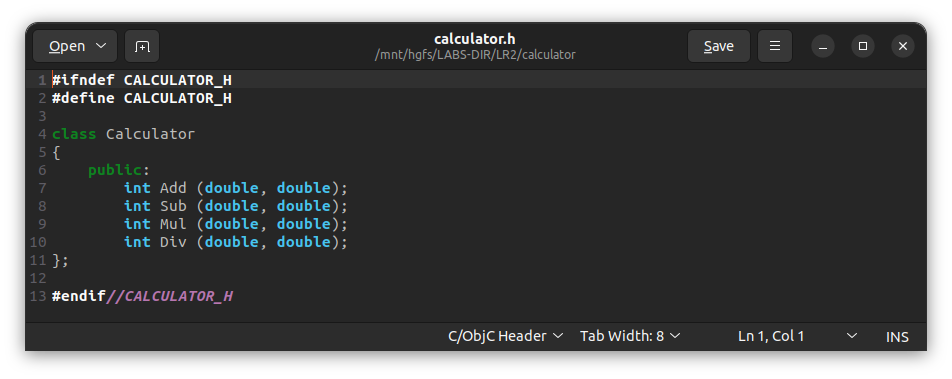
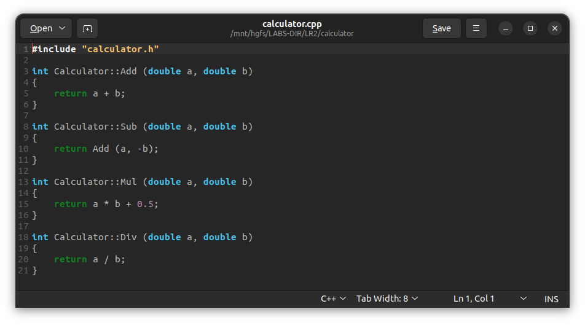
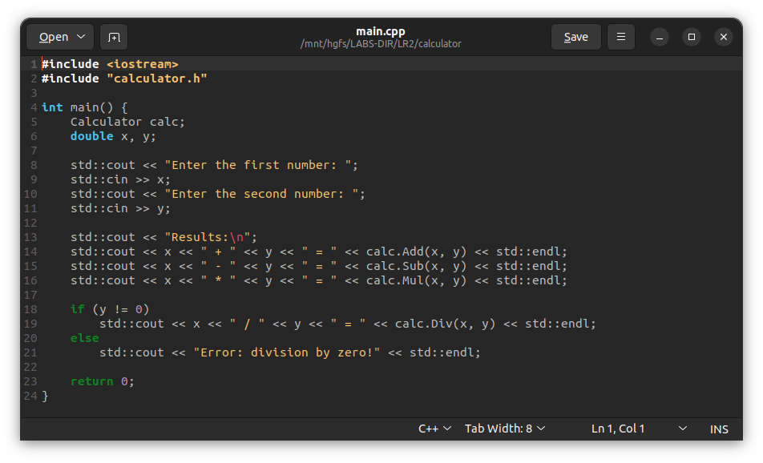
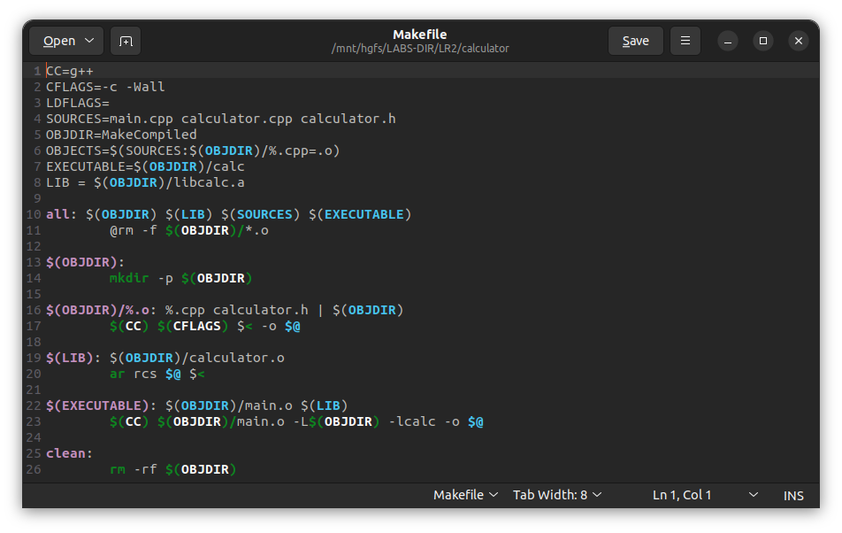
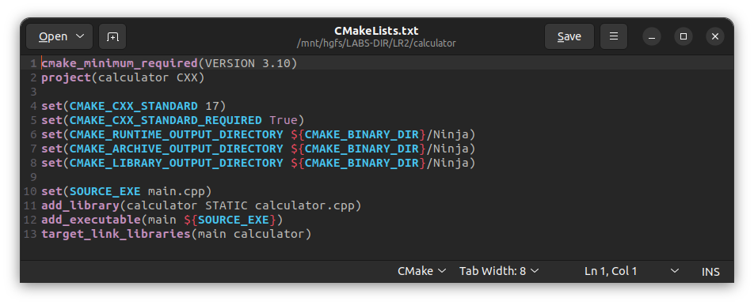
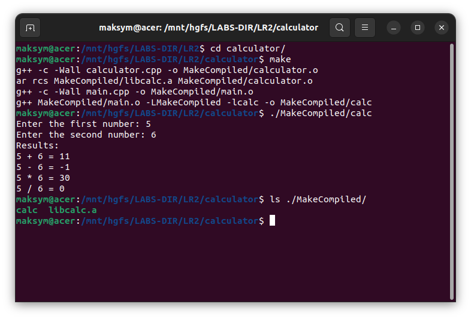
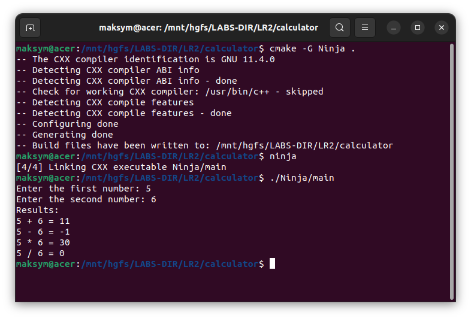

# Лабораторна робота №2

<strong>Група:</strong> ІО-42

<strong>Виконав:</strong> Куліков М. М.  
<strong>Номер в списку:</strong> 4209  
<strong>Перевірив:</strong> Каплунов А. В.

## **Тема:** 
Створення збірок програмного забезпечення за допомогою Make

## **Мета:** 
Ознайомлення з базовими принципами автоматизації збирання програмного забезпечення та набуття практичних навичок роботи із системами автоматизації збирання проєктів (Make, CMake, Ninja) для мови C++

## **Хід роботи:**
Створимо дуже маленький проєкт, який міститиме три файли (calculator.h, calculator.cpp, main.cpp). Їх вміст представлений на рисунках 1, 2 та 3:
 

   
  <i>Рисунок 1 – Вміст файлу calculator.h</i>

   
  <i>Рисунок 2 – Вміст файлу calculator.cpp</i>

   
  <i>Рисунок 3 – Вміст файлу main.cpp</i>

Для подальшої роботи з Make нам треба створити файл Makefile, який міститиме у собі набори відповідних правил. Впишемо туди відповідні команди. Код у цьому файлі представлений на рисунку 4.
 

   
  <i>Рисунок 4 – Вміст файлу Makefile</i>

Також створимо файл CMakeLists.txt, вміст якого представлений на рисунку 5.
 
 

   
  <i>Рисунок 5 – Вміст файлу CMakeLists.txt</i>

Тепер спробуємо створити збірку ПЗ. Результат виконання команди `make` і скомпільованої програми, та вміст папки «MakeCompiled» представлено на рисунку 6.
 
 

   
  <i>Рисунок 6 – Результат компілювання за допомогою команди make</i>

Тепер спробуємо використати файл CMakeLists.txt за допомогою системи збирання Ninja. Результати виконання команд `cmake -G Ninja .` та `ninja`, а також запуску скомпільованого файлу представлені на рисунку 7.

 

   
  <i>Рисунок 7 – Результат компілювання за допомогою Ninja</i>

# Висновки 
Отже, під час виконання лабораторної роботи було створено невеликий проєкт, а також написано базовий код для збірки бібліотеки та виконуваного файлу.  Для автоматизації процесу компіляції створено Makefile із додатковою секцією clean та CMakeLists.txt для системи збірки CMake. На основі CMakeLists.txt згенеровано сценарій збірки для системи Ninja (build.ninja і rules.ninja). У ході роботи було освоєно основні принципи організації проєктів у C++ і практично застосовано знання щодо роботи із системами автоматизації збірки. Проєкт було успішно зібрано та запущено, а репозиторій із вихідним кодом і файлами збірки розміщено на GitHub. Проблем під час виконання не виникло.