# Лабораторна робота №3

<div align="right">
<strong>Група:</strong> ІО-42

<strong>Виконав:</strong> Куліков М. М.  
<strong>Номер в списку:</strong> 4209  
<strong>Перевірив:</strong> Каплунов А. В.
</div>

## **Тема:** 
Розгортання Linux Kernel в середовищі емулятора QEMU для архітектури ARM

## **Мета:** 
Зібрати програмне середовище, завантажувач U-Boot, ядро Linux та BusyBox для архітектури ARM та запустити систему в QEMU.

## **Хід роботи:**

Роботу виконано на операційній системі Ubuntu 22.04 LTS. Для початку перевіримо версію системи та компілятора gcc командами `lsb_release -a` та `gcc --version`. Результат наведено нижче.

<p align="center">
  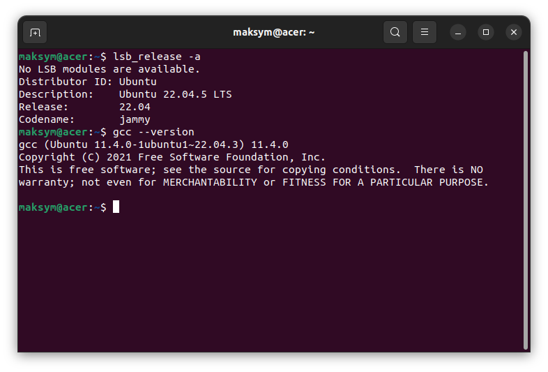<br>
  <i>Рисунок 1 – Версії операційної системи та gcc</i>
</p>

Оскільки в системі за замовчуванням встановлена новіша версія компілятора (що може призводити до помилок на кшталт yylloc під час збірки старого коду завантажувача), встановимо сумісну 9-ту версію GCC та зареєструємо її в системі за допомогою наступних команд:

```bash
sudo apt update
sudo apt install gcc-9 g++-9
sudo update-alternatives --install /usr/bin/gcc gcc /usr/bin/gcc-9 9
gcc --version
```

<p align="center">
  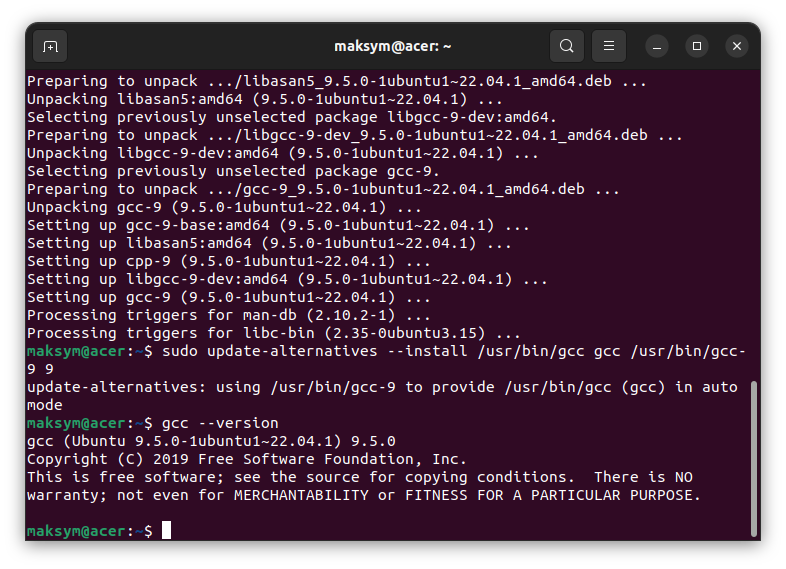<br>
  <i>Рисунок 2 – Зміна gcc</i>
</p>

### Частина 1. Підготовка інструментів

Оновимо список пакетів і встановимо інструменти, які знадобляться надалі: git для отримання вихідного коду, vim як редактор, tree та curl.

```bash
sudo apt update
sudo apt install git vim vim-gtk tree curl
```

<p align="center">
  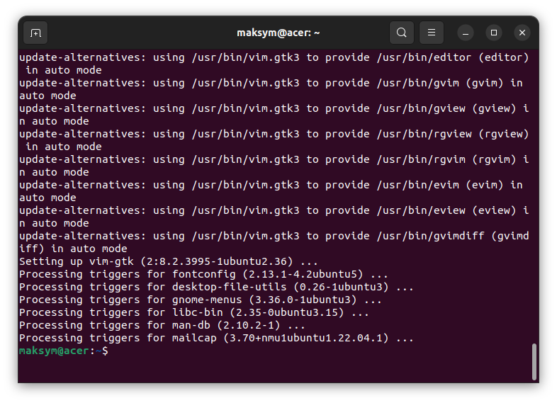<br>
  <i>Рисунок 3 – Оновлення пакетів і встановлення базових інструментів</i>
</p>

Далі встановимо ccache, який кешує об’єктні файли й прискорює повторні збірки, зокрема ядра. Встановимо розмір кешу 5 ГБ та перевіримо статистику.

```bash
sudo apt install ccache
ccache -M 5G
ccache -s
```

<p align="center">
  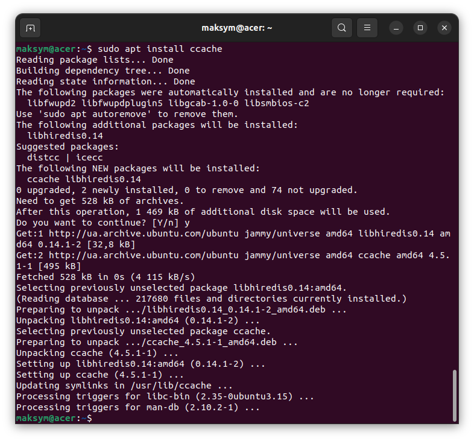<br>
  <i>Рисунок 4 – Встановлення ccache</i>
</p>

<p align="center">
  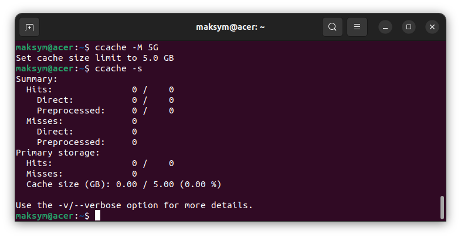<br>
  <i>Рисунок 5 – Налаштування розміру та статистика ccache</i>
</p>

Оскільки замість фізичної плати використовується емулятор QEMU, пункти 1.3 (послідовна консоль) і 1.4 (udev-правила для OTG USB) пропускаємо. Переходимо до тулчейнів. Нам потрібні два: bare-metal (arm-eabi) для збірки U-Boot і ядра та Linux (arm-linux-gnueabihf) для збірки BusyBox. Завантажимо архіви зі сайту ARM у каталог ~/Downloads

```bash
wget https://developer.arm.com/-/media/Files/downloads/gnu-a/8.3-2019.03/binrel/gcc-arm-8.3-2019.03-x86_64-arm-eabi.tar.xz
wget https://developer.arm.com/-/media/Files/downloads/gnu-a/8.3-2019.03/binrel/gcc-arm-8.3-2019.03-x86_64-arm-linux-gnueabihf.tar.xz
```

<p align="center">
  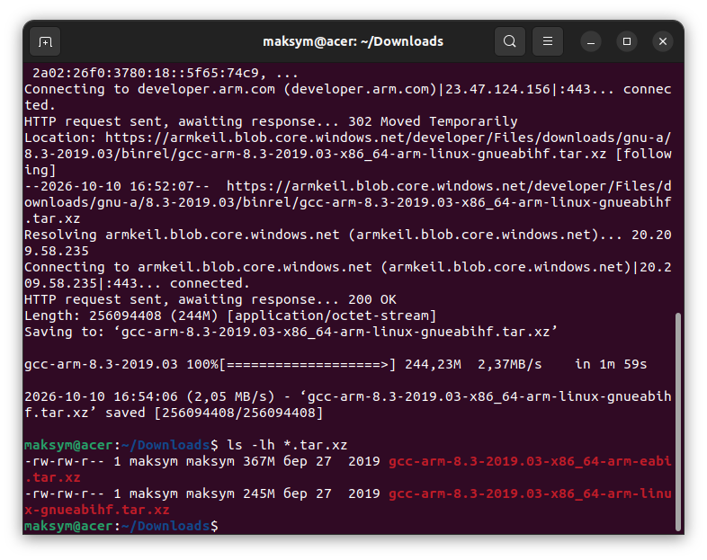<br>
  <i>Рисунок 6 – Завантажені архіви тулчейнів</i>
</p>

Розпакуємо обидва архіви в каталог /opt.

```bash
sudo tar xJvf gcc-arm-8.3-2019.03-x86_64-arm-eabi.tar.xz -C /opt/
sudo tar xJvf gcc-arm-8.3-2019.03-x86_64-arm-linux-gnueabihf.tar.xz -C /opt/
```

<p align="center">
  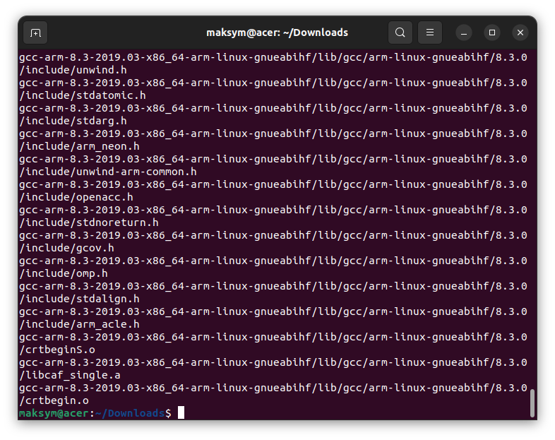<br>
  <i>Рисунок 7 – Розпакування тулчейнів до каталогу /opt</i>
</p>

<p align="center">
  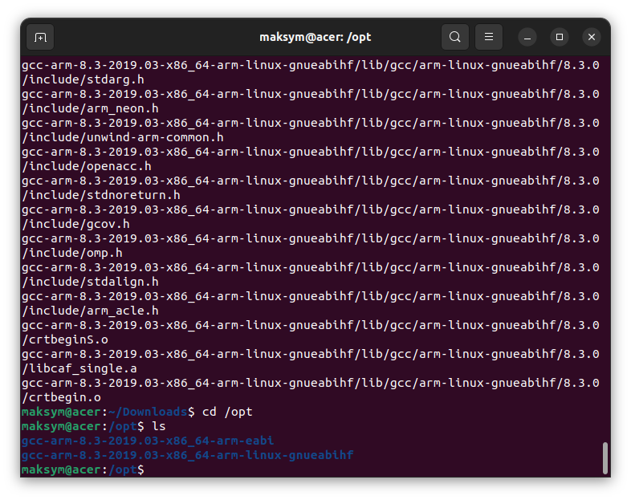<br>
  <i>Рисунок 8 – Вміст каталогу /opt</i>
</p>

### Частина 2. Отримання та збірка програмного забезпечення

Встановимо залежності, потрібні для збірки всіх проєктів, і створимо каталог ~/repos для вихідного коду.

```bash
sudo apt install make libncurses5-dev libssl-dev bc bison flex
mkdir ~/repos
```

<p align="center">
  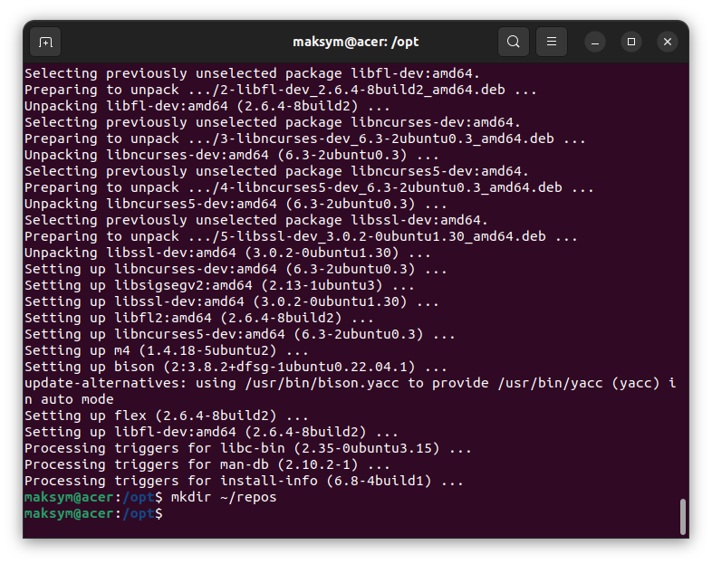<br>
  <i>Рисунок 9 – Встановлення залежностей для збірки</i>
</p>

#### 2.1 U-Boot

U-Boot — це завантажувач, який широко використовується у вбудованих системах. Клонуємо репозиторій, переглянемо останні релізні теги (без rc) і перейдемо на тег v2019.07.

```bash
cd ~/repos
git clone https://gitlab.denx.de/u-boot/u-boot.git
cd u-boot
git tag | grep -v rc | tail -5
git checkout v2019.07
```

<p align="center">
  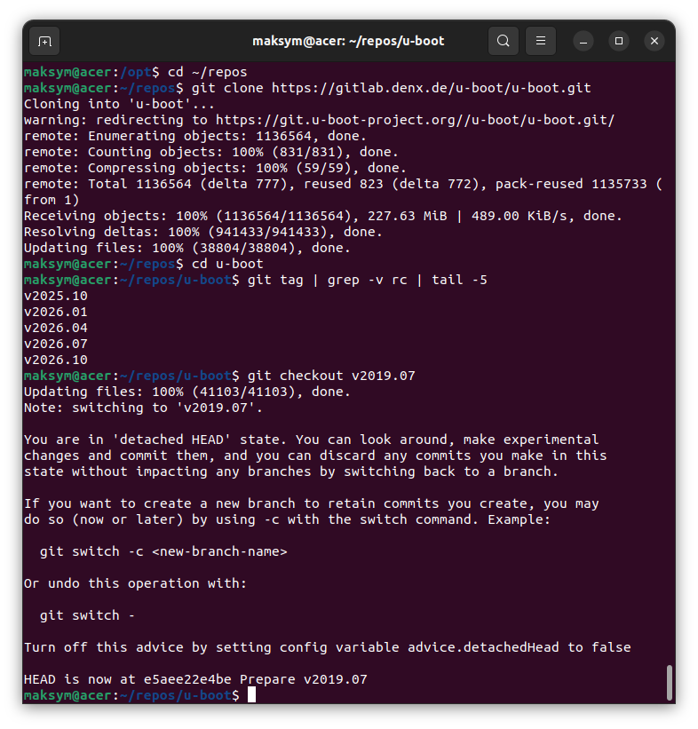<br>
  <i>Рисунок 10 – Отримання вихідного коду U-Boot</i>
</p>

Застосуємо серію патчів, яка ще очікує рецензування.

```bash
curl https://patchwork.ozlabs.org/series/130450/mbox/ | git am
```

<p align="center">
  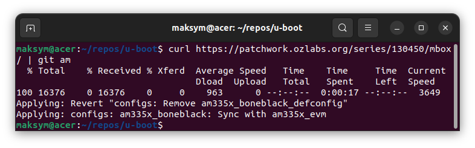<br>
  <i>Рисунок 11 – Застосування патч-серії до U-Boot</i>
</p>

Налаштуємо середовище для крос-компіляції bare-metal тулчейном. Ці команди не додаємо до ~/.bashrc.

```bash
export PATH=/opt/gcc-arm-8.3-2019.03-x86_64-arm-eabi/bin:$PATH
export CROSS_COMPILE='ccache arm-eabi-'
export ARCH=arm
```

<p align="center">
  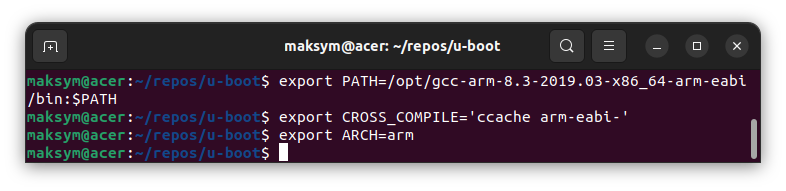<br>
  <i>Рисунок 12 – Налаштування середовища для збірки U-Boot</i>
</p>

Зберемо U-Boot з конфігурацією для BeagleBone Black.

```bash
make am335x_boneblack_defconfig
make -j4
```

<p align="center">
  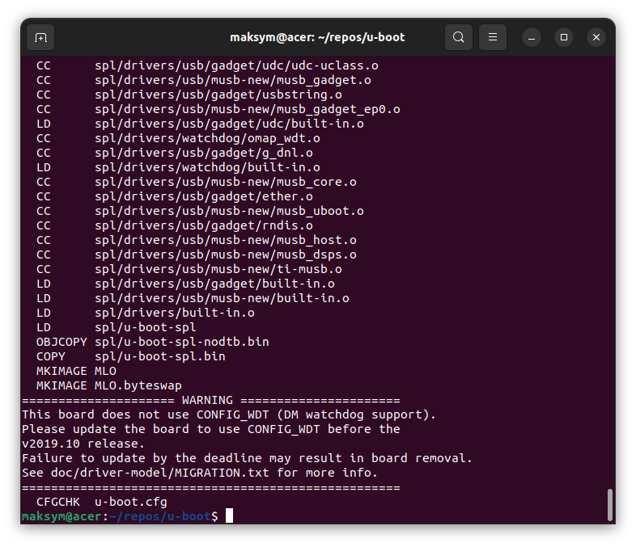<br>
  <i>Рисунок 13 – Збірка U-Boot</i>
</p>

Результатом збірки є файли MLO (завантажувач першого етапу) та u-boot.img (завантажувач другого етапу).

<p align="center">
  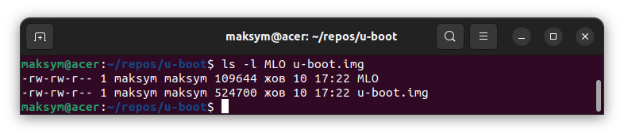<br>
  <i>Рисунок 14 – Результат збірки U-Boot</i>
</p>

#### 2.2 Ядро Linux

Клонуємо репозиторій linux-stable і перейдемо на останню longterm-гілку linux-4.19.y.

```bash
cd ~/repos
git clone git://git.kernel.org/pub/scm/linux/kernel/git/stable/linux-stable.git
cd linux-stable
git checkout linux-4.19.y
```

<p align="center">
  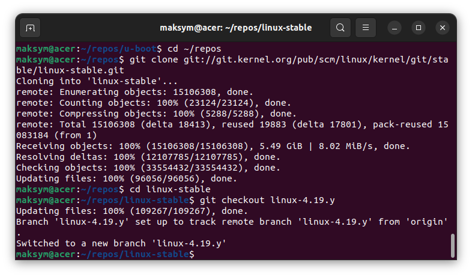<br>
  <i>Рисунок 15 – Отримання вихідного коду ядра</i>
</p>

Налаштуємо середовище, як і для U-Boot. За основу конфігурації візьмемо multi_v7_defconfig, а потрібні для BBB опції додамо фрагментом fragments/bbb.cfg.

```bash
export PATH=/opt/gcc-arm-8.3-2019.03-x86_64-arm-eabi/bin:$PATH
export CROSS_COMPILE='ccache arm-eabi-'
export ARCH=arm
mkdir fragments
nano fragments/bbb.cfg
```

<p align="center">
  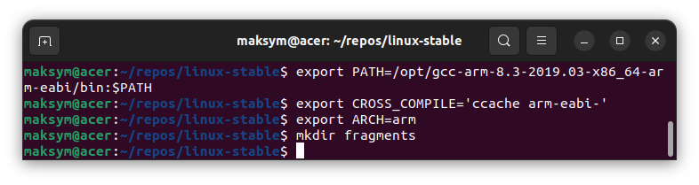<br>
  <i>Рисунок 16 – Налаштування середовища для збірки ядра</i>
</p>

<p align="center">
  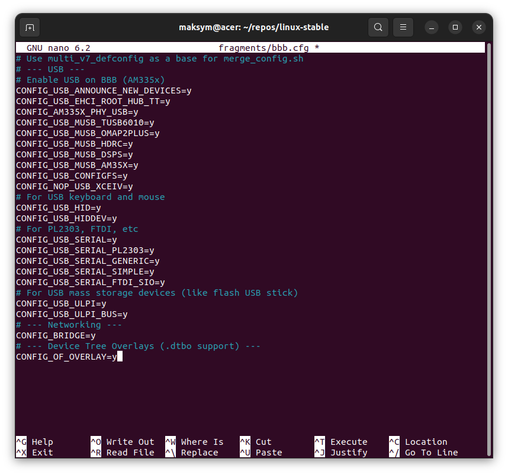<br>
  <i>Рисунок 17 – Вміст файлу bbb.cfg</i>
</p>

Згенеруємо файл .config з multi_v7_defconfig та нашого фрагмента.

```bash
./scripts/kconfig/merge_config.sh \
  arch/arm/configs/multi_v7_defconfig fragments/bbb.cfg
```

<p align="center">
  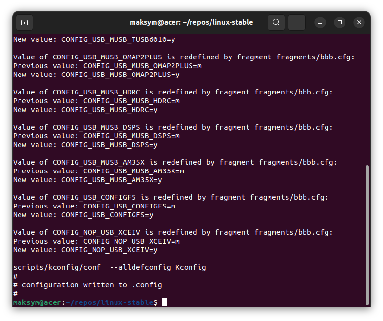<br>
  <i>Рисунок 18 – Генерація .config</i>
</p>

Зберемо образ ядра, device tree і модулі.

```bash
make -j4 zImage modules am335x-boneblack.dtb
```

<p align="center">
  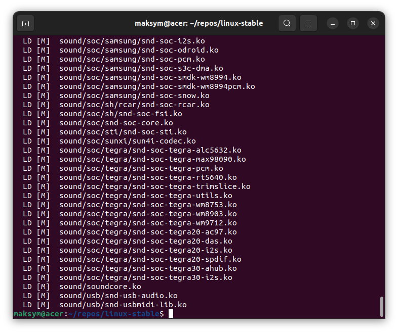<br>
  <i>Рисунок 19 – Збірка ядра Linux</i>
</p>

Результатом є файли arch/arm/boot/zImage та arch/arm/boot/dts/am335x-boneblack.dtb.

<p align="center">
  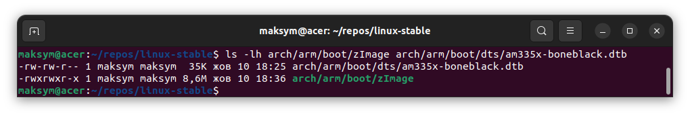<br>
  <i>Рисунок 20 – Результат збірки ядра</i>
</p>

#### 2.3 BusyBox

Зберемо мінімальну кореневу файлову систему на основі BusyBox. Клонуємо репозиторій і перейдемо на гілку 1_31_stable.

```bash
cd ~/repos
git clone git://git.busybox.net/busybox
cd busybox
git branch -a | grep stable | sort -V | tail -1
git checkout 1_31_stable
```

<p align="center">
  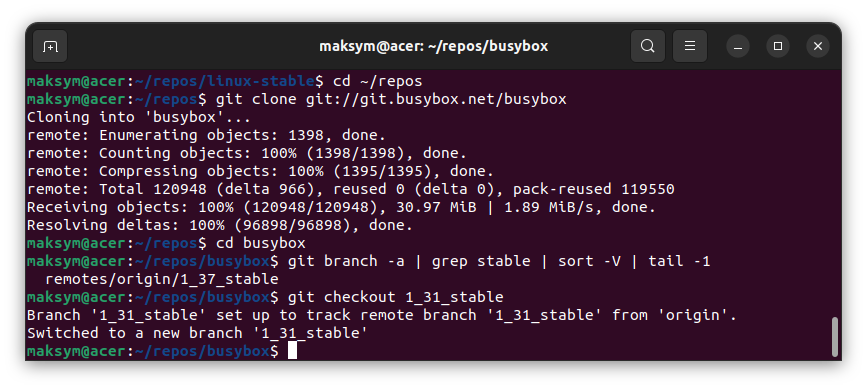<br>
  <i>Рисунок 21 – Отримання вихідного коду BusyBox</i>
</p>

Тепер використовуємо Linux-тулчейн. Налаштуємо середовище та згенеруємо повну конфігурацію.

```bash
export ARCH=arm
export PATH=/opt/gcc-arm-8.3-2019.03-x86_64-arm-linux-gnueabihf/bin:$PATH
export CROSS_COMPILE="ccache arm-linux-gnueabihf-"
make defconfig
```

<p align="center">
  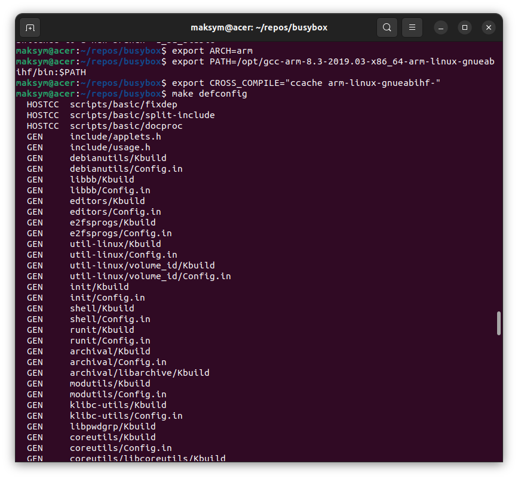<br>
  <i>Рисунок 22 – Налаштування середовища та конфігурації BusyBox</i>
</p>

Зберемо BusyBox, встановимо його в каталог _install та створимо потрібні каталоги.

```bash
make -j4
make install
mkdir -p _install/{boot,dev,etc\/init.d,lib,proc,root,sys\/kernel\/debug,tmp}
```

<p align="center">
  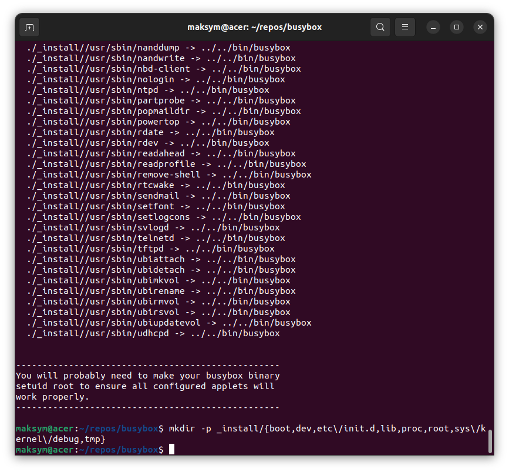<br>
  <i>Рисунок 23 – Збірка та встановлення BusyBox</i>
</p>

Створимо скрипт ініціалізації _install/etc/init.d/rcS, зробимо його виконуваним і створимо посилання init, щоб ядро могло запустити систему.

```bash
#!/bin/sh

mount -t sysfs none /sys
mount -t proc none /proc
mount -t debugfs none /sys/kernel/debug

echo /sbin/mdev > /proc/sys/kernel/hotplug
mdev -s
```

<p align="center">
  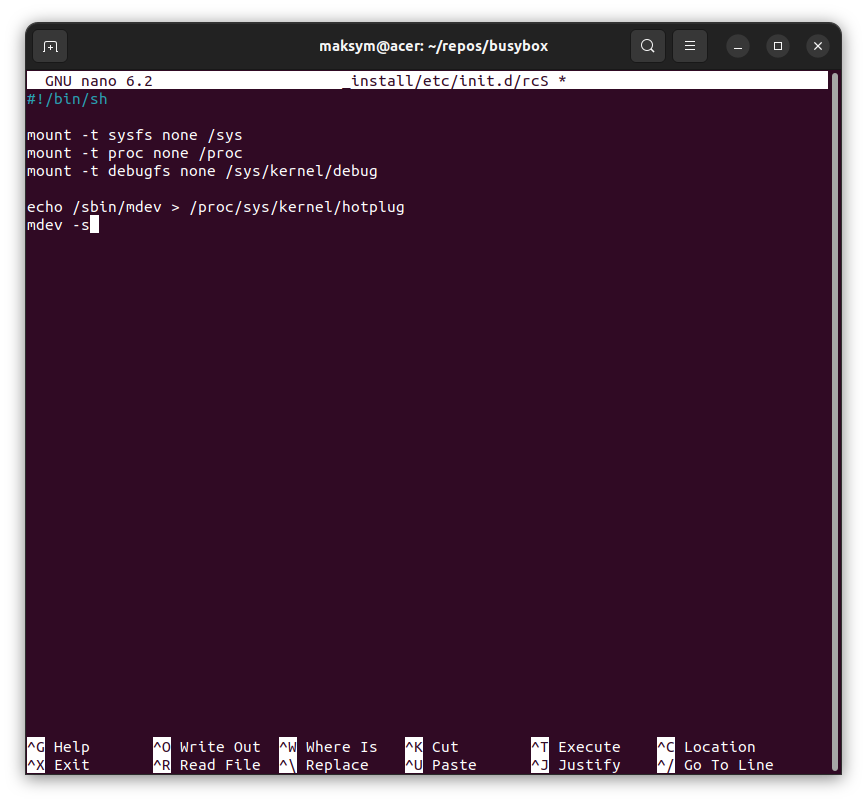<br>
  <i>Рисунок 24 – Скрипт ініціалізації rcS</i>
</p>

```bash
chmod +x _install/etc/init.d/rcS
ln -s bin/busybox _install/init
```

<p align="center">
  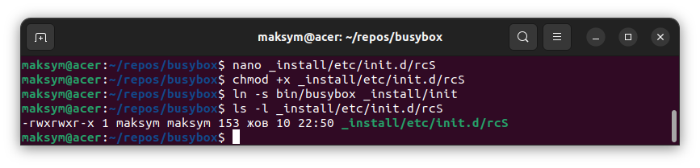<br>
  <i>Рисунок 25 – Права доступу до rcS та посилання init</i>
</p>

Наповнимо каталог /boot файлами ядра: zImage, am335x-boneblack.dtb, System.map та .config.

```bash
cd _install/boot
cp ~/repos/linux-stable/arch/arm/boot/zImage .
cp ~/repos/linux-stable/arch/arm/boot/dts/am335x-boneblack.dtb .
cp ~/repos/linux-stable/System.map .
cp ~/repos/linux-stable/.config ./config
cd -
```

<p align="center">
  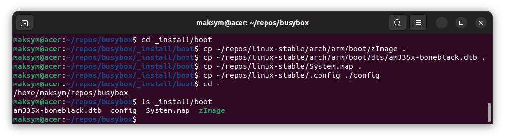<br>
  <i>Рисунок 26 – Наповнення каталогу /boot</i>
</p>

Наповнимо каталог /lib. Спочатку встановимо модулі ядра в кореневу файлову систему.

```bash
cd ~/repos/linux-stable
export INSTALL_MOD_PATH=~/repos/busybox/_install
export ARCH=arm
make modules_install
cd -
```

<p align="center">
  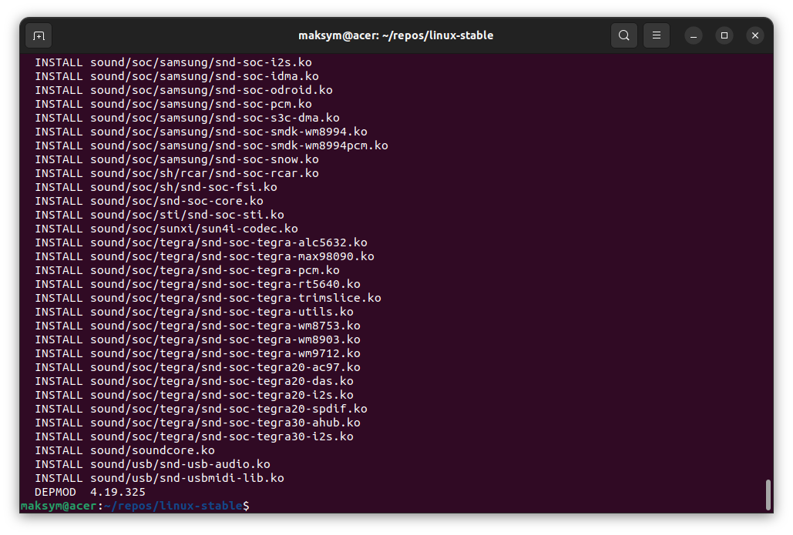<br>
  <i>Рисунок 27 – Встановлення модулів ядра</i>
</p>

Оскільки BusyBox зібрано динамічно, потрібно скопіювати бібліотеки тулчейна. Перевіримо залежності бінарного файлу та скопіюємо бібліотеки.

```bash
${CROSS_COMPILE}readelf -d _install/bin/busybox | grep NEEDED
cd _install/lib
libc_dir=$(${CROSS_COMPILE}gcc -print-sysroot)/lib
cp -a $libc_dir/*.so* .
cd -
```

<p align="center">
  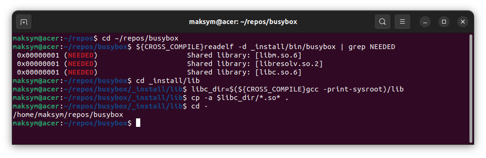<br>
  <i>Рисунок 28 – Копіювання системних бібліотек у /lib</i>
</p>

Наповнимо каталог /etc: конфігурація mdev, файли group, passwd, shadow і resolv.conf.

```bash
echo '$MODALIAS=.* root:root 660 @modprobe "$MODALIAS"' > _install/etc/mdev.conf
echo 'root:x:0:' > _install/etc/group
echo 'root:x:0:0:root:/root:/bin/sh' > _install/etc/passwd
echo 'root::10933:0:99999:7:::' > _install/etc/shadow
echo "nameserver 8.8.8.8" > _install/etc/resolv.conf
```

<p align="center">
  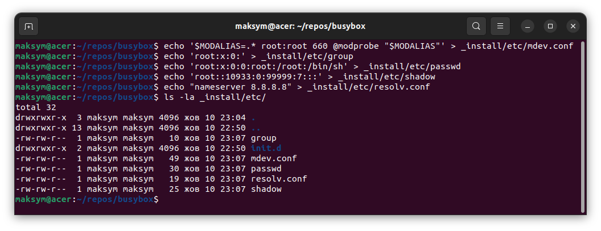<br>
  <i>Рисунок 29 – Наповнення каталогу /etc</i>
</p>

### Частина 3. Запуск в емуляторі QEMU

Встановимо QEMU та створимо стиснений CPIO-архів кореневої файлової системи.

```bash
sudo apt install qemu-system-arm
cd ~/repos/busybox/_install
find . | cpio -o -H newc | gzip > ../rootfs.cpio.gz
cd ..
```

<p align="center">
  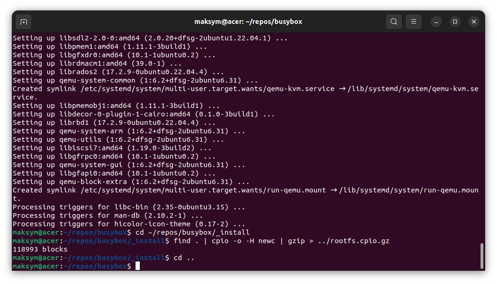<br>
  <i>Рисунок 30 – Встановлення QEMU</i>
</p>

<p align="center">
  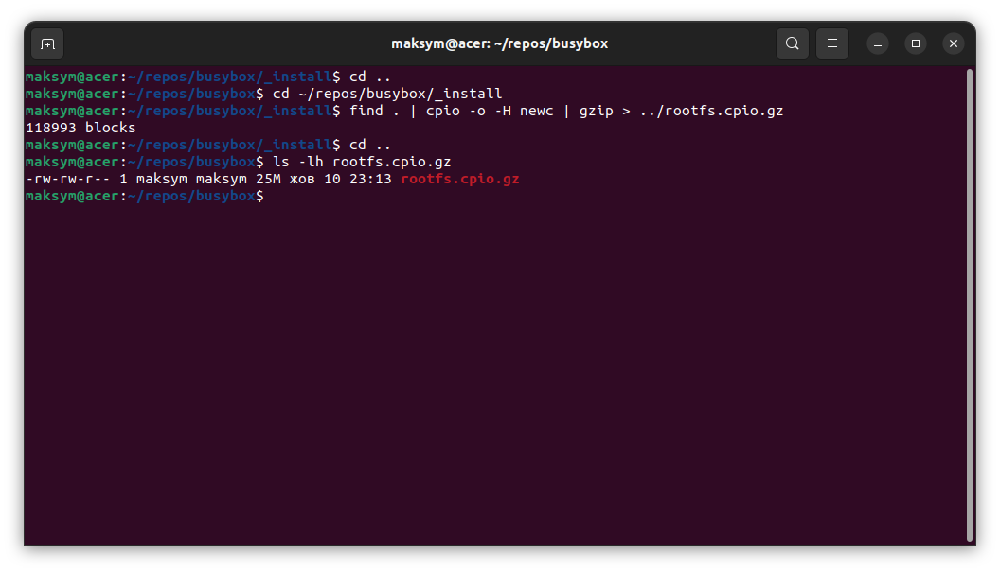<br>
  <i>Рисунок 31 – Створення CPIO-архіву кореневої файлової системи</i>
</p>

Запустимо ядро з кореневою файловою системою в QEMU. Використовується машина virt, тому dtb і завантажувач не потрібні, а rootfs підключається як RAM-диск.

```bash
qemu-system-arm -kernel _install/boot/zImage -initrd rootfs.cpio.gz \
  -machine virt -nographic -m 512 \
  --append "root=/dev/ram0 rw console=ttyAMA0,115200 mem=512M"
```

<p align="center">
  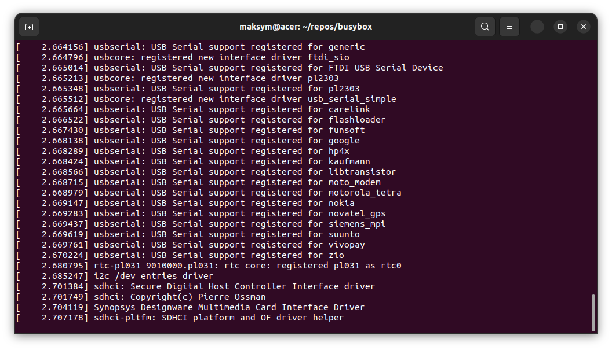<br>
  <i>Рисунок 32 – Початок завантаження ядра в QEMU</i>
</p>

<p align="center">
  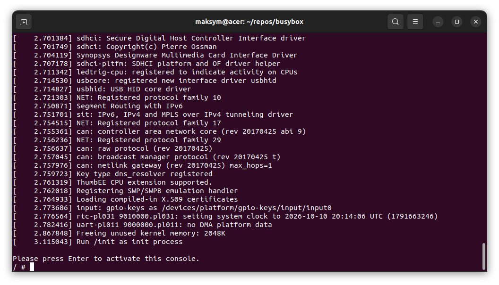<br>
  <i>Рисунок 33 – Завершення завантаження системи</i>
</p>

Після завершення завантаження натиснемо Enter і виконаємо команди, що підтверджують роботу зібраної системи.

```bash
uname -a
ls -l
dmesg | grep init
busybox --help | head -15
poweroff
```

<p align="center">
  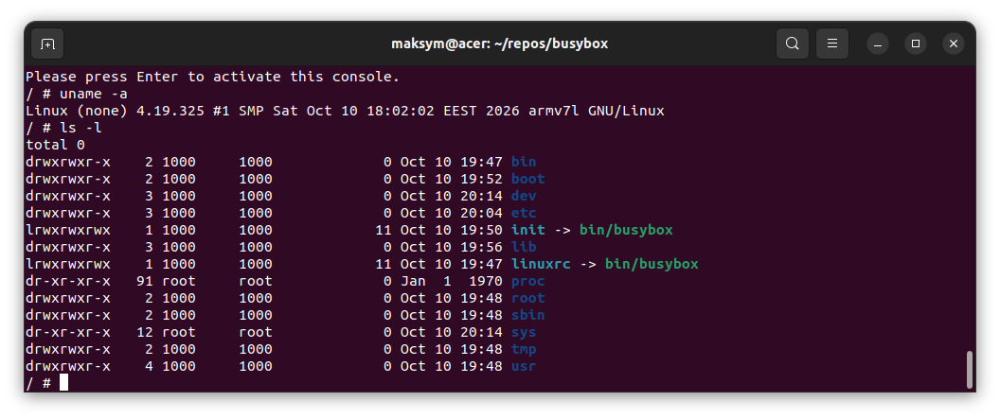<br>
  <i>Рисунок 34 – Результат виконання uname -a та ls -l</i>
</p>

<p align="center">
  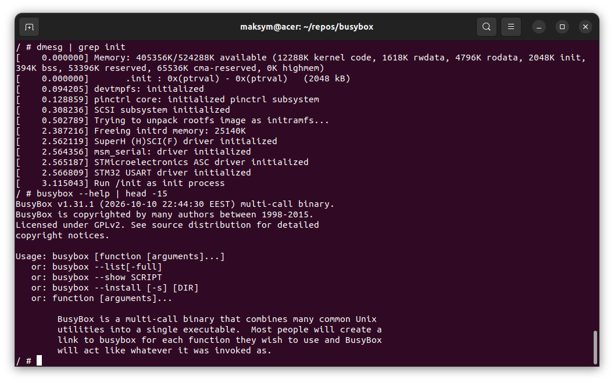<br>
  <i>Рисунок 35 – Результат виконання dmesg та busybox --help</i>
</p>

<p align="center">
  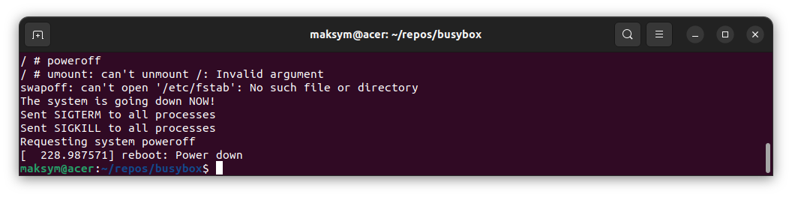<br>
  <i>Рисунок 36 – Завершення роботи QEMU</i>
</p>

# Висновки 

Отже, під час виконання лабораторної роботи розгорнуто середовище для крос-компіляції під архітектуру ARM: встановлено ccache та два тулчейни (bare-metal і Linux). Зібрано завантажувач U-Boot (MLO та u-boot.img), ядро Linux 4.19 з конфігурацією multi_v7_defconfig і фрагментом для BeagleBone Black, а також мінімальну кореневу файлову систему на основі BusyBox із каталогами /boot, /lib та /etc. Отриману систему успішно запущено в емуляторі QEMU на машині virt, а виконані команди uname, ls, dmesg і busybox підтвердили її коректну роботу. Щоб уникнути помилки multiple definition of yylloc, яка виникає під час збірки U-Boot компілятором gcc 10 і новіших, ще до початку збірки було встановлено gcc 9 та перемкнено на нього систему, тому проблем під час виконання не виникло.
