# Лабораторна робота №4

<div align="right">
<strong>Група:</strong> ІО-42

<strong>Виконав:</strong> Куліков М. М.  
<strong>Номер в списку:</strong> 9  
<strong>Перевірив:</strong> Каплунов А. В.
</div>

## **Тема:** 
Розроблення модулів Linux Kernel (частина 1)

## **Мета:** 
Ознайомитись зі збиранням завантажуваних модулів ядра Linux, параметрами модуля, списками ядра та динамічним виділенням пам'яті; перевірити роботу модуля в емуляторі QEMU.

## **Хід роботи:**

### Частина 1. Підготовка та перший приклад

Роботу виконано на ОС Ubuntu 22.04 LTS. Ядро Linux (linux-4.19.y) уже зібране в лабораторній роботі №3, тому всі файли для компіляції модулів готові. Додамо змінну KDIR з шляхом до каталогу ядра до команд export, що використовувалися для збирання ядра.

```bash
export PATH=/opt/gcc-arm-8.3-2019.03-x86_64-arm-eabi/bin:$PATH
export CROSS_COMPILE='ccache arm-eabi-'
export ARCH=arm
export KDIR=$HOME/repos/linux-stable
```

<p align="center">
  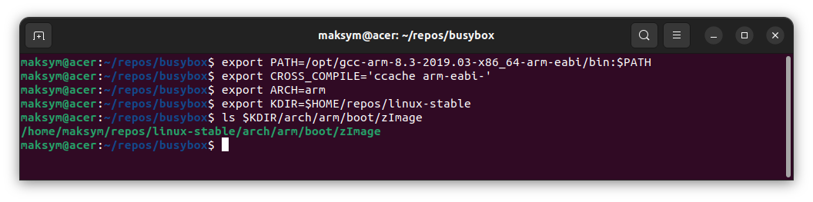<br>
  <i>Рисунок 1 – Налаштування середовища та перевірка, що ядро зібране</i>
</p>

Переглянемо три надані приклади (test1, test2, test3). Драйвер у них однаковий, відрізняється лише система збирання: у test1 усе в одному Makefile, у test2 Makefile і Kbuild існують окремо, у test3 Makefile підключає Kbuild через include. Для подальшої роботи обрано test3. Вміст файлів Makefile та Kbuild наведено на рисунках нижче.

<p align="center">
  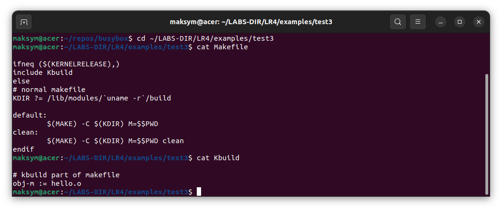<br>
  <i>Рисунок 2 – Вміст файлів Makefile та Kbuild (test3)</i>
</p>

Зберемо вихідний модуль і завантажимо його в QEMU. Файл hello.ko копіюємо в кореневу файлову систему BusyBox (каталог _install/root), перепаковуємо СРІО-архів і запускаємо QEMU так само, як у лабораторній роботі №3.

```bash
cd ~/LABS-DIR/LR4/hello
make
cp hello.ko ~/repos/busybox/_install/root/
cd ~/repos/busybox/_install
find . | cpio -o -H newc | gzip > ../rootfs.cpio.gz
cd ..
qemu-system-arm -kernel _install/boot/zImage -initrd rootfs.cpio.gz -machine virt -nographic -m 512 --append "root=/dev/ram0 rw console=ttyAMA0,115200 mem=512M"
```

<p align="center">
  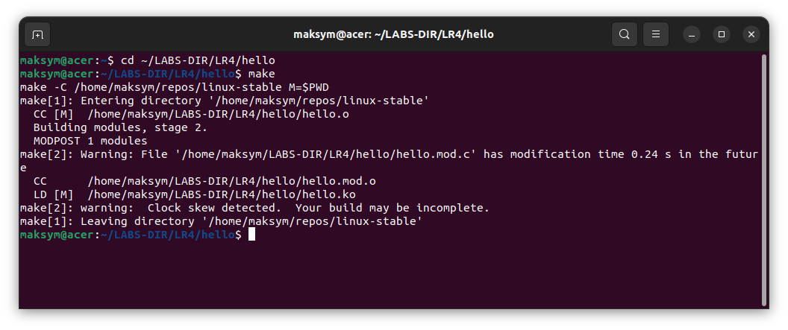<br>
  <i>Рисунок 3 – Збирання початкового модуля командою make</i>
</p>

<p align="center">
  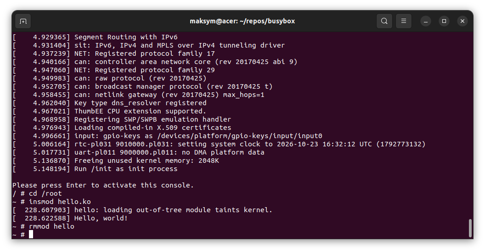<br>
  <i>Рисунок 4 – Insmod та rmmod початкового модуля в QEMU</i>
</p>

### Частина 2. Модифікація модуля

До модуля додано параметр count типу uint (стандартно 1), який визначає, скільки разів буде надруковано «Hello, world!». Для 0 та значень від 5 до 10 друкується попередження, але робота продовжується. Для значень більше 10 функція ініціалізації видає помилку і повертає -EINVAL, тож модуль не завантажується. Опис параметра додано макросом MODULE_PARM_DESC (виводиться командою modinfo).

Також оголошено структуру hello_event з полями struct list_head node та ktime_t time, статичну голову списку hello_list (LIST_HEAD). Перед кожним друком привітання викликом kmalloc виділяється пам'ять під екземпляр структури, куди заноситься час ktime_get(), і елемент додається в кінець списку. У hello_exit() виконується прохід списком (list_for_each_entry_safe): друкується час події в наносекундах, елемент вилучається з list_del, пам'ять звільняється через kfree. Якщо kmalloc повертає NULL, уже створені елементи звільняються і повертається -ENOMEM, щоб не було витоку пам'яті.

Код модуля hello.c (без ліцензійного заголовка):

```c
#include <linux/init.h>
#include <linux/module.h>
#include <linux/printk.h>
#include <linux/list.h>
#include <linux/ktime.h>
#include <linux/slab.h>

MODULE_AUTHOR("Serhii Popovych <serhii.popovych@globallogic.com>");
MODULE_DESCRIPTION("Hello, world in Linux Kernel Training");
MODULE_LICENSE("Dual BSD/GPL");

static uint count = 1;
module_param(count, uint, 0444);
MODULE_PARM_DESC(count, "Times to print \"Hello, world!\" (default 1, max 10)");

struct hello_event {
	struct list_head node;
	ktime_t time;
};

static LIST_HEAD(hello_list);

static void hello_flush(void)
{
	struct hello_event *ev, *tmp;

	list_for_each_entry_safe(ev, tmp, &hello_list, node) {
		pr_info("Event time: %lld ns\n", ktime_to_ns(ev->time));
		list_del(&ev->node);
		kfree(ev);
	}
}

static int __init hello_init(void)
{
	uint i;

	if (count == 0 || (count >= 5 && count <= 10))
		pr_warn("Parameter count = %u, continuing anyway\n", count);

	if (count > 10) {
		pr_err("Parameter count = %u is greater than 10\n", count);
		return -EINVAL;
	}

	for (i = 0; i < count; i++) {
		struct hello_event *ev = kmalloc(sizeof(*ev), GFP_KERNEL);

		if (!ev) {
			hello_flush();
			return -ENOMEM;
		}
		ev->time = ktime_get();
		list_add_tail(&ev->node, &hello_list);
		pr_emerg("Hello, world!\n");
	}
	return 0;
}

static void __exit hello_exit(void)
{
	hello_flush();
}

module_init(hello_init);
module_exit(hello_exit);
```

Для відповідності Linux Kernel Coding Style перевіримо файл скриптом checkpatch.pl. Позначок ERROR немає, залишені лише допустимі зауваження.

```bash
$KDIR/scripts/checkpatch.pl -f hello.c
```

<p align="center">
  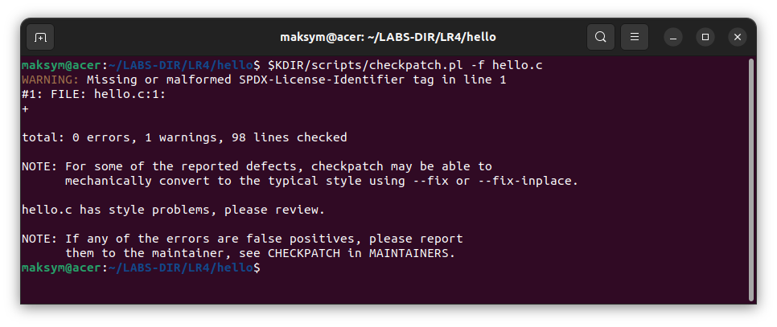<br>
  <i>Рисунок 5 – Результат checkpatch.pl -f hello.c</i>
</p>

Зберемо модуль і перевіримо його метадані та опис параметра командою modinfo. Після змін копіюємо файли у кореневу файлову систему BusyBox.

```bash
make clean
make
modinfo hello.ko
```

<p align="center">
  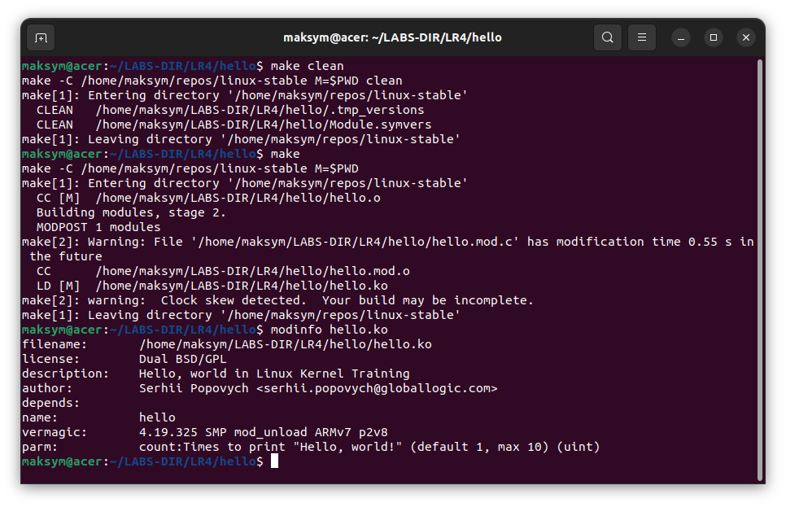<br>
  <i>Рисунок 6 – Результат make та modinfo hello.ko (рядок parm: count)</i>
</p>

### Частина 3. Перевірка в QEMU

Завантажимо ядро в QEMU та послідовно виконаємо insmod/rmmod зі значеннями параметра: без параметра, 0, довільним значенням від 1 до 10, довільним значенням більше 10. Після завантаження переглянемо встановлене значення в sysfs.

#### 3.1 Без параметра (значення за умовчанням 1)

```bash
insmod hello.ko
cat /sys/module/hello/parameters/count
rmmod hello
```

<p align="center">
  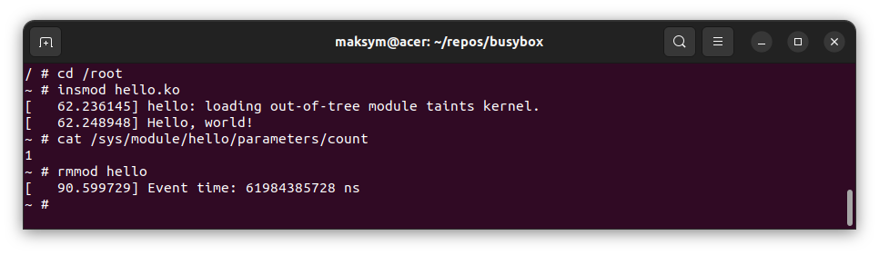<br>
  <i>Рисунок 7 – Insmod/rmmod без параметра, вивід sysfs</i>
</p>

#### 3.2 count=0 (очікується попередження, рядок «Hello, world!» не виводиться)

```bash
insmod hello.ko count=0
rmmod hello
```

<p align="center">
  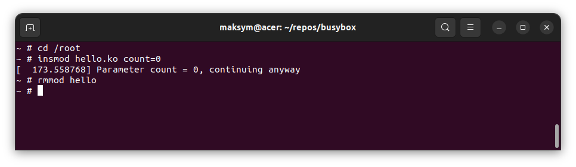<br>
  <i>Рисунок 8 – Insmod/rmmod з count=0</i>
</p>

#### 3.3 count=3 (значення в межах 1–4: без попередження)

```bash
insmod hello.ko count=3
cat /sys/module/hello/parameters/count
rmmod hello
```

<p align="center">
  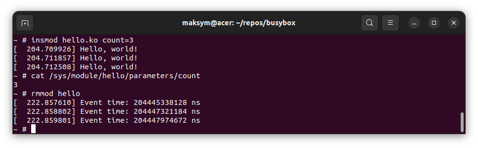<br>
  <i>Рисунок 9 – Insmod/rmmod з count=3, вивід значення параметра</i>
</p>

#### 3.4 count=7 (діапазон 5–10: попередження, робота продовжується)

```bash
insmod hello.ko count=7
rmmod hello
```

<p align="center">
  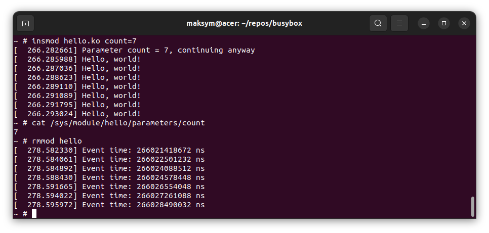<br>
  <i>Рисунок 10 – Insmod/rmmod з count=7</i>
</p>

#### 3.5 count=15 (більше 10: помилка, модуль не завантажується)

```bash
insmod hello.ko count=15
lsmod
```

<p align="center">
  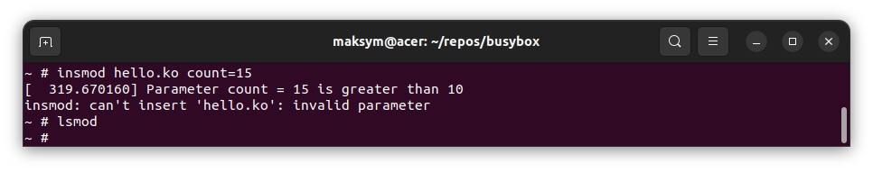<br>
  <i>Рисунок 11 – Insmod з count=15</i>
</p>

# Висновки

Отже, під час виконання лабораторної роботи розглянуто три варіанти системи збирання модулів ядра і обрано один з них (test3). Модуль доповнено параметром count типу uint з описом для modinfo та перевіркою значень (попередження для 0 та чисел в діапазоні 5-10, помилка -EINVAL при значеннях більше 10), а також списком структур з часом ktime_get(), які виділяються через kmalloc і звільняються через kfree під час вивантаження модуля. Роботу модуля перевірено в QEMU командами insmod/rmmod з різними значеннями параметра, значення параметра переглянуто в /sys/module/hello/parameters. Вихідний код модуля та Makefile/Kbuild розміщено в репозиторії: https://github.com/BronievM/KPI-AK2/tree/main/LR4