# Лабораторна робота №5

<div align="right">
<strong>Група:</strong> ІО-42

<strong>Виконав:</strong> Куліков М. М.  
<strong>Номер в списку:</strong> 9  
<strong>Перевірив:</strong> Каплунов А. В.
</div>

## **Тема:** 
Розроблення модулів Linux Kernel (частина 2)

## **Мета:** 
Навчитись розділяти проєкт на кілька модулів ядра Linux, експортувати функції між модулями, підключати каталог із заголовковими файлами до системи збирання, використовувати макроси pr_err/pr_warn/pr_info; дослідити залежності між модулями в QEMU.

## **Хід роботи:**

### Частина 1. Підготовка

Роботу виконано на ОС Ubuntu 22.04 LTS на основі лабораторної роботи №4. Ядро Linux (linux-4.19.y) зібране в лабораторній роботі №3. Скопіюємо проєкт з ЛР4 в новий каталог і задамо змінні середовища.

```bash
cp -r ~/LABS-DIR/LR4/hello ~/LABS-DIR/LR5/hello
cd ~/LABS-DIR/LR5/hello
mkdir inc
export PATH=/opt/gcc-arm-8.3-2019.03-x86_64-arm-eabi/bin:$PATH
export CROSS_COMPILE='ccache arm-eabi-'
export ARCH=arm
export KDIR=$HOME/repos/linux-stable
```

<p align="center">
  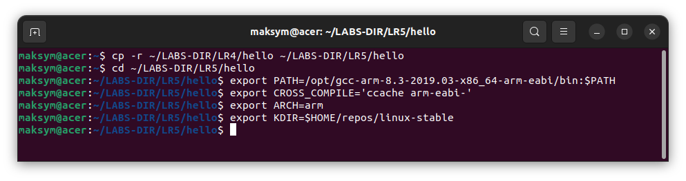<br>
  <i>Рисунок 1 – Підготовка каталогу LR5 та змінних середовища</i>
</p>

### Частина 2. Розділення проєкту на два модулі

Проєкт розділено на два модулі. Модуль hello1 містить усю роботу зі списком і експортує функцію print_hello(). Модуль hello2 містить параметр count (за умовчанням 1, перевірки 0, 5–10 та більше 10 збережені з ЛР4) і викликає print_hello() count разів.

Заголовковий файл hello1.h винесено в підкаталог inc. Щоб файли *.c могли підключати його директивою #include "hello1.h" без шляху, у Kbuild додано ccflags-y += -I$(src)/inc.

Вміст файлу Kbuild:

```makefile
# kbuild part of makefile
obj-m := hello1.o hello2.o
ccflags-y += -I$(src)/inc
```

Вміст файлу Makefile:

```makefile
ifneq ($(KERNELRELEASE),)
include Kbuild
else
# normal makefile
KDIR ?= /lib/modules/`uname -r`/build

default:
    $(MAKE) -C $(KDIR) M=$$PWD
clean:
    $(MAKE) -C $(KDIR) M=$$PWD clean
endif
```

<p align="center">
  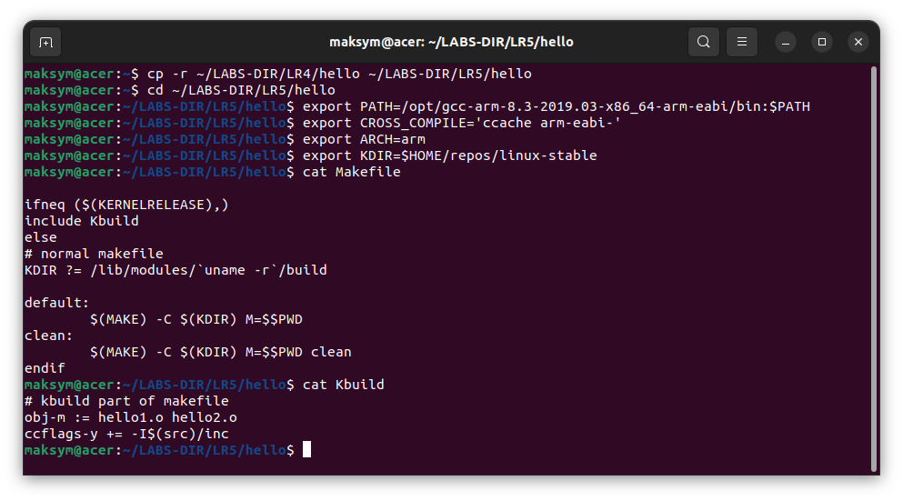<br>
  <i>Рисунок 2 – Вміст файлів Makefile та Kbuild</i>
</p>

Вміст inc/hello1.h:

```c
/* SPDX-License-Identifier: Dual BSD/GPL */
#ifndef _HELLO1_H
#define _HELLO1_H

/* Print "Hello, world!" and remember how long the print took */
void print_hello(void);

#endif /* _HELLO1_H */
```

<p align="center">
  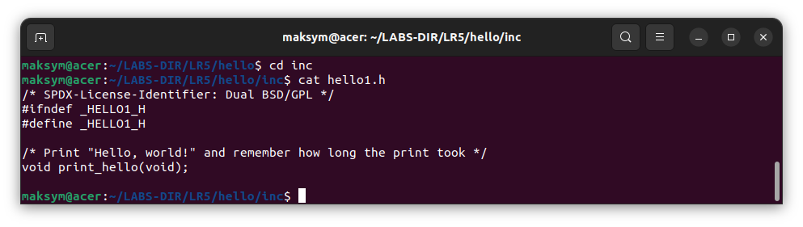<br>
  <i>Рисунок 3 – Вміст файлу inc/hello1.h</i>
</p>

Модуль hello1. Структура hello_event, окрім struct list_head, містить два поля ktime_t: time_before та time_after. Функція print_hello() виділяє пам’ять через kmalloc, записує ktime_get() до та після друку привітання (pr_info) і додає елемент у список. Функція hello1_exit() проходить списком, друкує тривалість кожного друку (time_after − time_before) у наносекундах, вилучає елемент і звільняє пам’ять.

Вміст файлу hello1.c:

```c
#include <linux/init.h>
#include <linux/module.h>
#include <linux/printk.h>
#include <linux/list.h>
#include <linux/ktime.h>
#include <linux/slab.h>

#include "hello1.h"

MODULE_AUTHOR("Edited by Maksym Kulikov, originally created by Serhii Popovych");
MODULE_DESCRIPTION("Hello, world in Linux Kernel Training: print module");
MODULE_LICENSE("Dual BSD/GPL");

struct hello_event {
    struct list_head node;
    ktime_t time_before;
    ktime_t time_after;
};

static LIST_HEAD(hello_list);

void print_hello(void)
{
    struct hello_event *ev = kmalloc(sizeof(*ev), GFP_KERNEL);

    if (!ev) {
        pr_err("Cannot allocate memory for event\n");
        return;
    }

    ev->time_before = ktime_get();
    pr_info("Hello, world!\n");
    ev->time_after = ktime_get();

    list_add_tail(&ev->node, &hello_list);
}
EXPORT_SYMBOL(print_hello);

static int __init hello1_init(void)
{
    return 0;
}

static void __exit hello1_exit(void)
{
    struct hello_event *ev, *tmp;

    list_for_each_entry_safe(ev, tmp, &hello_list, node) {
        pr_info("Print took %lld ns\n",
            ktime_to_ns(ktime_sub(ev->time_after, ev->time_before)));
        list_del(&ev->node);
        kfree(ev);
    }
}

module_init(hello1_init);
module_exit(hello1_exit);
```

<p align="center">
  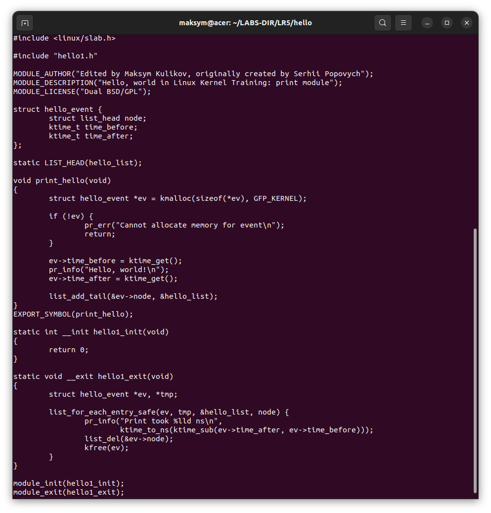<br>
  <i>Рисунок 4 – Вміст файлу hello1.c</i>
</p>

Модуль hello2.c:

```c
#include <linux/init.h>
#include <linux/module.h>
#include <linux/printk.h>

#include "hello1.h"

MODULE_AUTHOR("Edited by Maksym Kulikov, originally created by Serhii Popovych");
MODULE_DESCRIPTION("Hello, world in Linux Kernel Training: user module");
MODULE_LICENSE("Dual BSD/GPL");

static uint count = 1;
module_param(count, uint, 0444);
MODULE_PARM_DESC(count, "Times to print \"Hello, world!\" (default 1, max 10)");

static int __init hello2_init(void)
{
    uint i;

    if (count == 0 || (count >= 5 && count <= 10))
        pr_warn("Parameter count = %u, continuing anyway\n", count);

    if (count > 10) {
        pr_err("Parameter count = %u is greater than 10\n", count);
        return -EINVAL;
    }

    for (i = 0; i < count; i++)
        print_hello();

    return 0;
}

static void __exit hello2_exit(void)
{
    /* Nothing to do: the list is owned by hello1 */
}

module_init(hello2_init);
module_exit(hello2_exit);
```

<p align="center">
  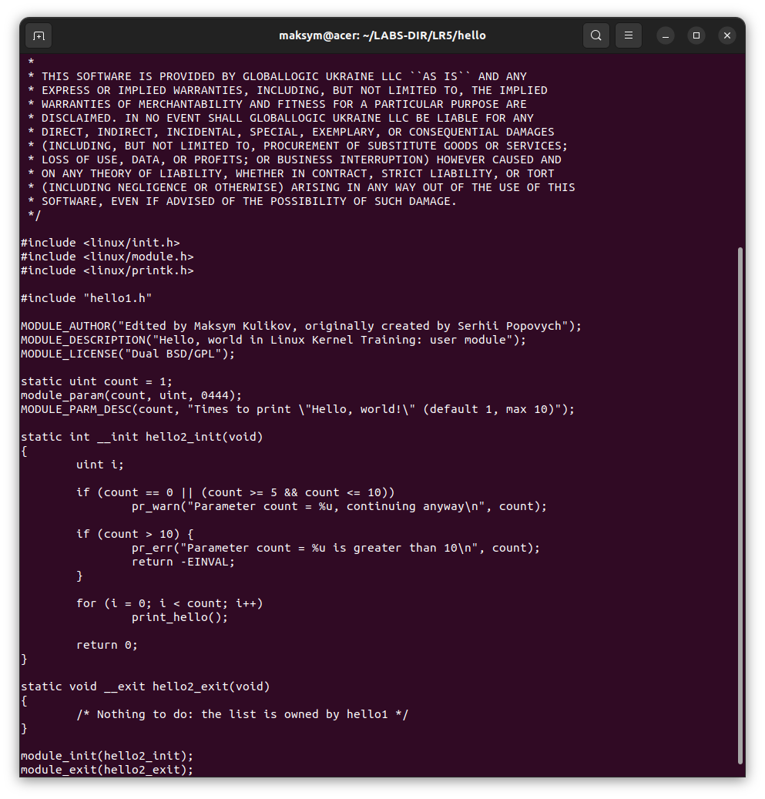<br>
  <i>Рисунок 5 – Вміст файлу hello2.c</i>
</p>

Усі виклики printk замінено на pr_err (помилки: count > 10, невдале виділення пам’яті), pr_warn (попередження для count = 0 та 5–10) і pr_info (привітання та час друку). Перевіримо файли скриптом checkpatch.pl, зберемо модулі та переглянемо метадані (у hello2 в рядку depends має з’явитись hello1).

```bash
$KDIR/scripts/checkpatch.pl -f hello1.c hello2.c inc/hello1.h
make
modinfo hello1.ko
modinfo hello2.ko
```

<p align="center">
  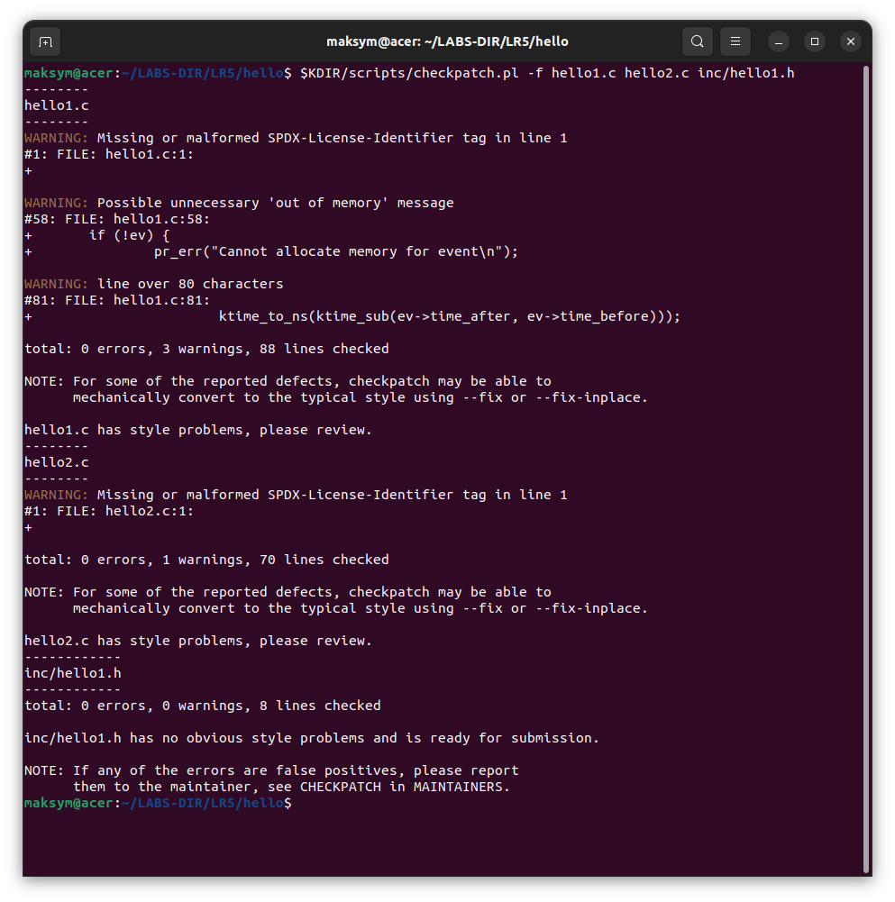<br>
  <i>Рисунок 6 – Результат checkpatch.pl</i>
</p>

Результат checkpatch.pl: 0 errors. У hello1.c є 3 warnings (відсутній SPDX-тег у першому рядку — ліцензійний заголовок узято з прикладу; «Possible unnecessary 'out of memory' message» — повідомлення про помилку виділення пам’яті залишено навмисно для діагностики; один рядок довший за 80 символів), у hello2.c — 1 warning (SPDX). Файл inc/hello1.h зауважень не має.

<p align="center">
  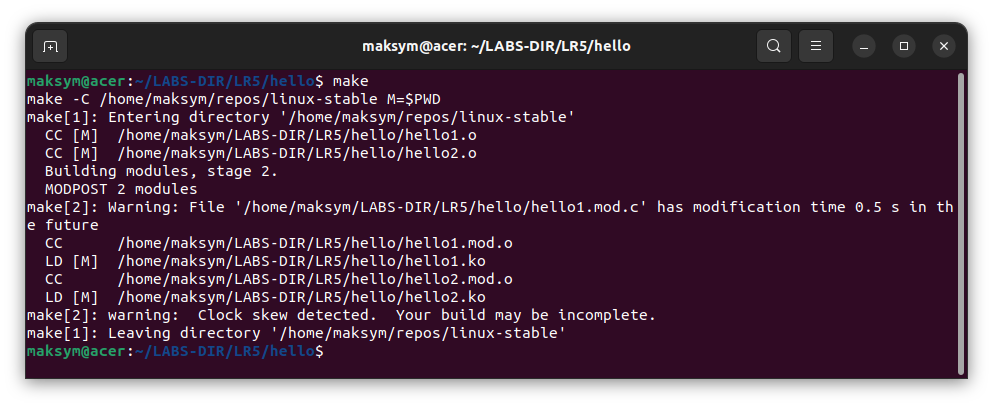<br>
  <i>Рисунок 7 – Результат make</i>
</p>

<p align="center">
  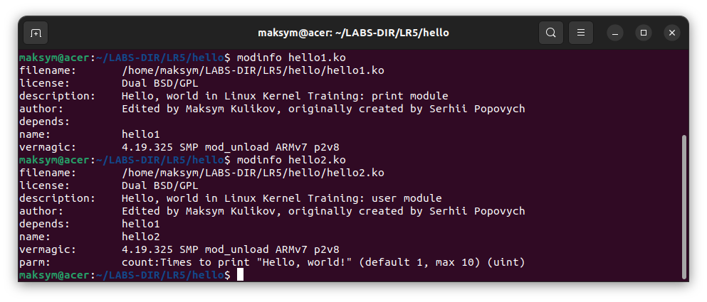<br>
  <i>Рисунок 8 – Результат modinfo hello1.ko та modinfo hello2.ko</i>
</p>

### Частина 3. Перевірка в QEMU

Скопіюємо hello1.ko та hello2.ko в кореневу файлову систему BusyBox, перепакуємо CPIO-архів і запустимо QEMU.

```bash
cp hello1.ko hello2.ko ~/repos/busybox/_install/root/
cd ~/repos/busybox/_install
find . | cpio -o -H newc | gzip > ../rootfs.cpio.gz
cd ..
qemu-system-arm -kernel _install/boot/zImage -initrd rootfs.cpio.gz -machine virt -nographic -m 512 --append "root=/dev/ram0 rw console=ttyAMA0,115200 mem=512M"
```

<p align="center">
  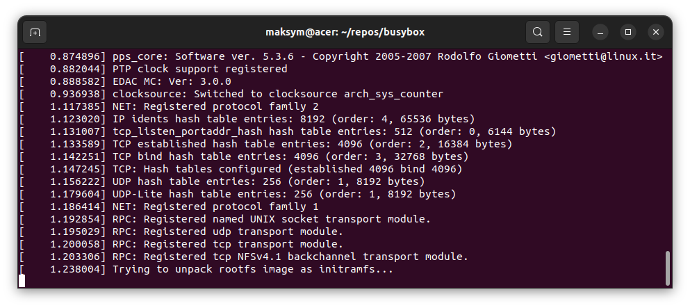<br>
  <i>Рисунок 9 – Запуск QEMU</i>
</p>

Спочатку завантажуємо hello1.ko, потім hello2.ko. Вивантажуємо у зворотному порядку: спочатку hello2, потім hello1 (під час rmmod hello1 друкується час кожного друку). Повідомлення шукаємо командою dmesg | grep.

#### 3.1 Без параметра (значення за умовчанням 1)

```bash
insmod hello1.ko
insmod hello2.ko
cat /sys/module/hello2/parameters/count
lsmod
rmmod hello2
rmmod hello1
```

<p align="center">
  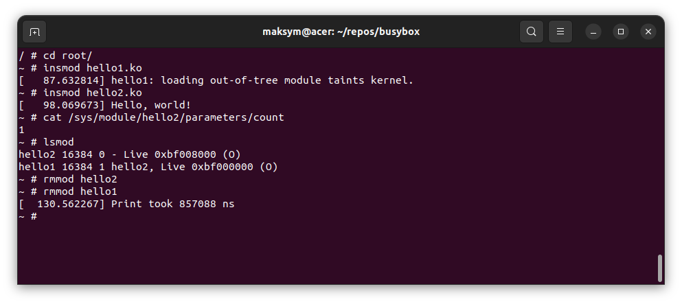<br>
  <i>Рисунок 10 – insmod/rmmod без параметра, вивід sysfs та lsmod</i>
</p>

#### 3.2 count=0 (pr_warn, привітання не друкується)

```bash
insmod hello1.ko
insmod hello2.ko count=0
rmmod hello2
rmmod hello1
```

<p align="center">
  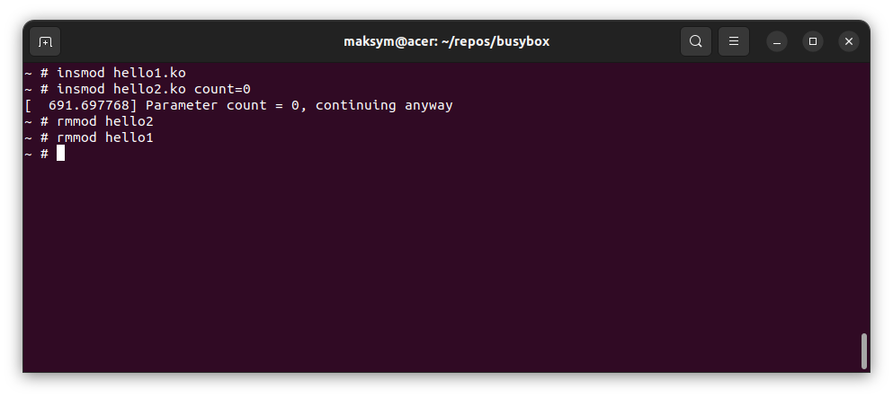<br>
  <i>Рисунок 11 – insmod/rmmod з count=0</i>
</p>

#### 3.3 count=3 (без попередження, три привітання та три часи друку)

```bash
insmod hello1.ko
insmod hello2.ko count=3
cat /sys/module/hello2/parameters/count
rmmod hello2
rmmod hello1
```

<p align="center">
  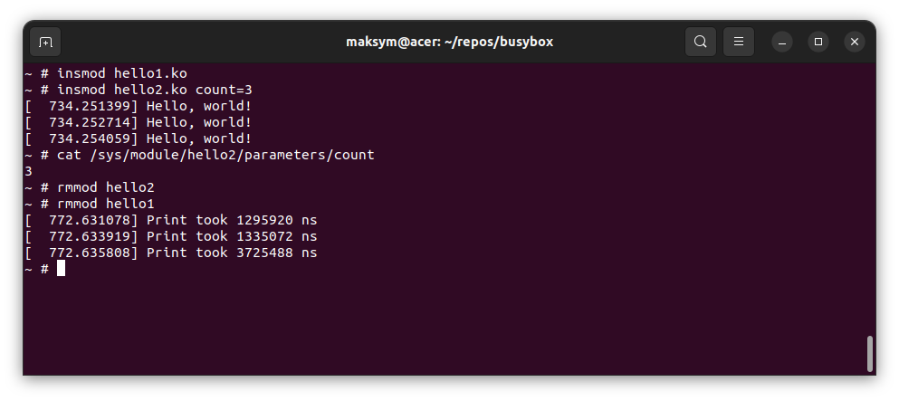<br>
  <i>Рисунок 12 – insmod/rmmod з count=3, вивід значення параметра</i>
</p>

#### 3.4 count=7 (pr_warn і продовження роботи)

```bash
insmod hello1.ko
insmod hello2.ko count=7
rmmod hello2
rmmod hello1
```

<p align="center">
  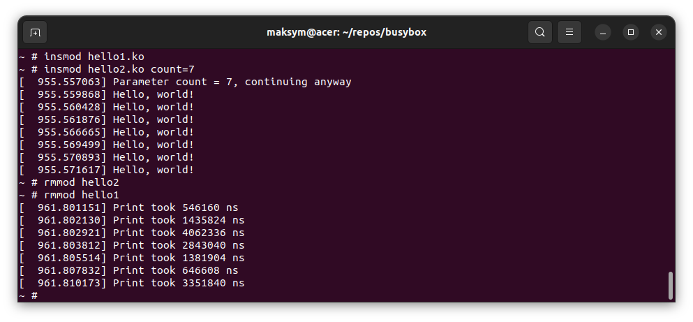<br>
  <i>Рисунок 13 – insmod/rmmod з count=7</i>
</p>

#### 3.5 count=15 (pr_err, hello2 не завантажується)

```bash
insmod hello1.ko
insmod hello2.ko count=15
lsmod
rmmod hello1
```

<p align="center">
  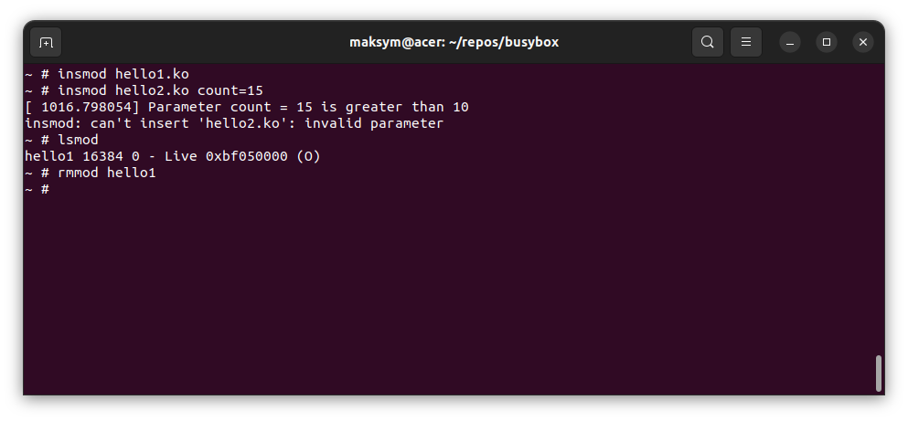<br>
  <i>Рисунок 14 – insmod з count=15: помилка -EINVAL, у lsmod лише hello1</i>
</p>

#### 3.6 Пошук усіх повідомлень у журналі ядра

```bash
dmesg | grep -E 'Hello|Parameter|Print'
```

<p align="center">
  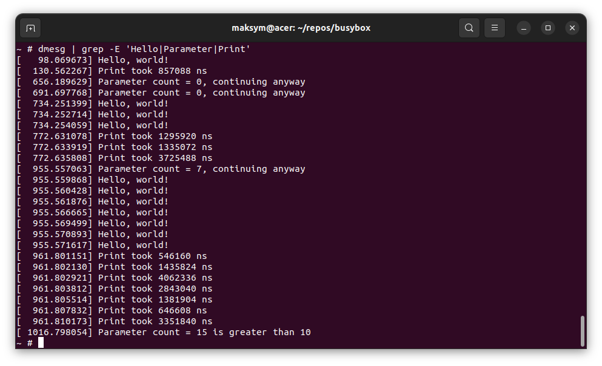<br>
  <i>Рисунок 15 – Результат dmesg | grep (pr_info, pr_warn, pr_err)</i>
</p>

#### 3.7 Завантаження hello2.ko без hello1.ko

```bash
insmod hello2.ko
dmesg | tail -3
```

<p align="center">
  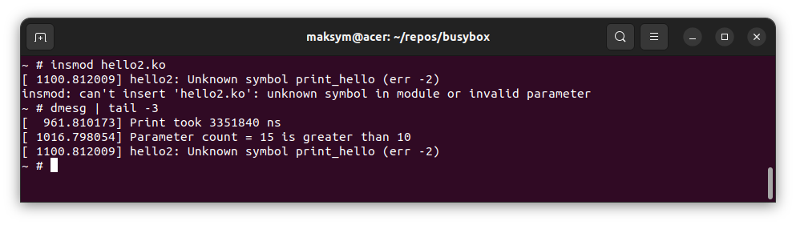<br>
  <i>Рисунок 16 – insmod hello2.ko без hello1.ko та dmesg</i>
</p>

Результат: insmod завершується помилкою «can't insert 'hello2.ko': unknown symbol in module or invalid parameter», а в dmesg з’являється повідомлення «hello2: Unknown symbol print_hello (err -2)». Це відбувається через те, що hello2 використовує функцію print_hello(), яку експортує hello1 через EXPORT_SYMBOL. Поки hello1 не завантажений, символу print_hello немає в таблиці символів ядра, тому під час завантаження hello2 ядро не може розв’язати посилання, і insmod завершується помилкою. Про залежність свідчить рядок depends: hello1 у виводі modinfo hello2.ko. Саме тому правильний порядок: спочатку insmod hello1.ko, потім hello2.ko, а вивантаження у зворотному порядку.

# Висновки

Отже, під час виконання лабораторної роботи проєкт з ЛР4 розділено на два модулі: hello1 (робота зі списком, вимірювання часу друку через два поля ktime_t, експорт функції print_hello()) та hello2 (параметр count і виклики print_hello()). Заголовковий файл винесено в підкаталог inc і підключено через ccflags-y, printk замінено на pr_err, pr_warn та pr_info. Перевірено завантаження модулів у QEMU з різними значеннями параметра, знайдено всі повідомлення через dmesg | grep. Спроба завантажити hello2.ko без hello1.ko завершилась помилкою «Unknown symbol print_hello», оскільки експортований символ відсутній у ядрі до завантаження hello1. Вихідний код розміщено в репозиторії: https://github.com/BronievM/KPI-AK2/tree/main/LR5
