# Лабораторна робота №6

<div align="right">
<strong>Група:</strong> ІО-42

<strong>Виконав:</strong> Куліков М. М.  
<strong>Номер в списку:</strong> 9  
<strong>Перевірив:</strong> Каплунов А. В.
</div>

## **Тема:** 
Налагодження модулів Linux Kernel

## **Мета:** 
Ознайомитись із засобами налагодження модулів ядра Linux: макросом BUG_ON(), повідомленнями Oops, адресами секцій модуля в sysfs, інструментами objdump/gdb; навчитись знаходити місце аварії в коді модуля за повідомленням Oops.

## **Хід роботи:**

### Частина 1. Підготовка

Роботу виконано на ОС Ubuntu 22.04 LTS на основі лабораторної роботи №4. Ядро Linux (linux-4.19.y) зібране в лабораторній роботі №3. Скопіюємо проєкт з ЛР4 в новий каталог і задамо змінні середовища.

```bash
cp -r ~/LABS-DIR/LR4/hello ~/LABS-DIR/LR6/hello
cd ~/LABS-DIR/LR6/hello
export PATH=/opt/gcc-arm-8.3-2019.03-x86_64-arm-eabi/bin:$PATH
export CROSS_COMPILE='ccache arm-eabi-'
export ARCH=arm
export KDIR=$HOME/repos/linux-stable
```

<p align="center">
  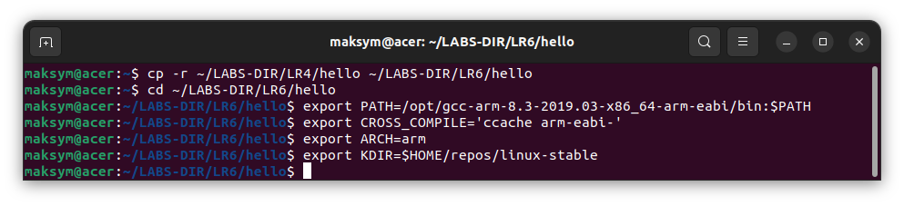<br>
  <i>Рисунок 1 – Підготовка каталогу LR6 та змінних середовища</i>
</p>

### Частина 2. Модифікація модуля (завдання 1)

Замість друку повідомлення про помилку та повернення -EINVAL для значення параметра count більше 10 додано BUG_ON(count > 10).

Додано примусове внесення помилки «начебто kmalloc() повернув 0» для п’ятого елемента списку (i == 4). Перевірку на NULL свідомо прибрано, тому код працює з нульовим вказівником ev, і аварія виникає під час першого ж звернення до нього в блоці вставки в список. На практиці це запис за адресою 0x00000000, що детально розглянуто в частині 4.

Makefile та Kbuild змінено аналогічно appendix1. Додано ccflags-y += -g (налагоджувальна інформація), збереження hello.ko.unstripped перед strip -g та правило для генерації %.s / %.i. Для утиліт binutils із CROSS_COMPILE прибирається префікс ccache.

Вміст файлу Kbuild:

```makefile
# kbuild part of makefile
obj-m := hello.o
ccflags-y += -g # add debugging info
```

Вміст файлу Makefile:

```makefile
ifneq ($(KERNELRELEASE),)
include Kbuild
else
# normal makefile
KDIR ?= /lib/modules/`uname -r`/build
# strip "ccache " from CROSS_COMPILE for binutils
BINUTILS = $(subst ccache ,,$(CROSS_COMPILE))

default:
	$(MAKE) -C $(KDIR) M=$$PWD
	cp hello.ko hello.ko.unstripped
	$(BINUTILS)strip -g hello.ko # strip only debugging info
clean:
	$(MAKE) -C $(KDIR) M=$$PWD clean

%.s %.i: %.c
	$(MAKE) -C $(KDIR) M=$$PWD $@
endif
```

<p align="center">
  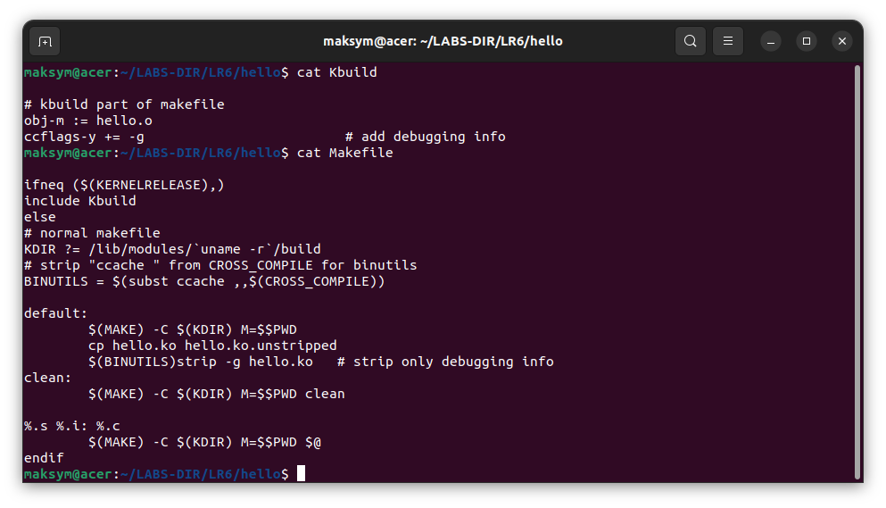<br>
  <i>Рисунок 2 – Вміст файлів Makefile та Kbuild</i>
</p>

Код модуля hello.c (без ліцензійного заголовка):

```c
#include <linux/init.h>
#include <linux/module.h>
#include <linux/printk.h>
#include <linux/list.h>
#include <linux/ktime.h>
#include <linux/slab.h>

MODULE_AUTHOR("Edited by Maksym Kulikov, originally created by Serhii Popovych");
MODULE_DESCRIPTION("Lab 6: Debugging (BUG_ON & Oops analisys)");
MODULE_LICENSE("Dual BSD/GPL");

static uint count = 1;
module_param(count, uint, 0444);
MODULE_PARM_DESC(count, "Times to print \"Hello, world!\" (default 1, max 10)");

struct hello_event {
	struct list_head node;
	ktime_t time;
};

static LIST_HEAD(hello_list);

/* Print time of every event, then remove it from the list and free it */
static void hello_flush(void)
{
	struct hello_event *ev, *tmp;

	list_for_each_entry_safe(ev, tmp, &hello_list, node) {
		pr_info("Event time: %lld ns\n", ktime_to_ns(ev->time));
		list_del(&ev->node);
		kfree(ev);
	}
}

static int __init hello_init(void)
{
	uint i;

	if (count == 0 || (count >= 5 && count <= 10))
		pr_warn("Parameter count = %u, continuing anyway\n", count);

	/* Task 1: invalid parameter value is a fatal error now */
	BUG_ON(count > 10);

	for (i = 0; i < count; i++) {
		struct hello_event *ev;

		if (i == 4)
			ev = NULL; /* pretend that kmalloc() returned 0 */
		else
			ev = kmalloc(sizeof(*ev), GFP_KERNEL);

		/* No NULL check on purpose: ev is NULL for i == 4 */
		ev->time = ktime_get();
		list_add_tail(&ev->node, &hello_list);
		pr_emerg("Hello, world!\n");
	}
	return 0;
}

static void __exit hello_exit(void)
{
	hello_flush();
}

module_init(hello_init);
module_exit(hello_exit);
```

<p align="center">
  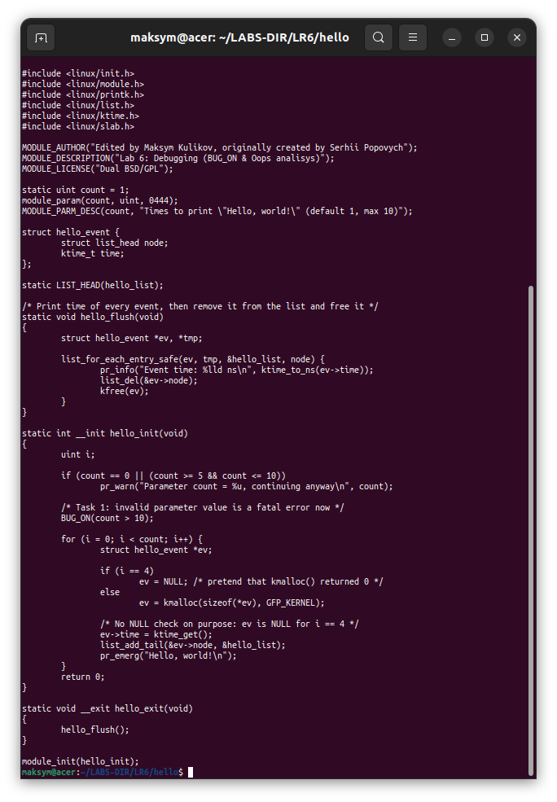<br>
  <i>Рисунок 3 – Вміст файлу hello.c</i>
</p>

Перевіримо стиль і зберемо модуль.

```bash
$KDIR/scripts/checkpatch.pl -f hello.c
make
ls hello.ko hello.ko.unstripped
```

<p align="center">
  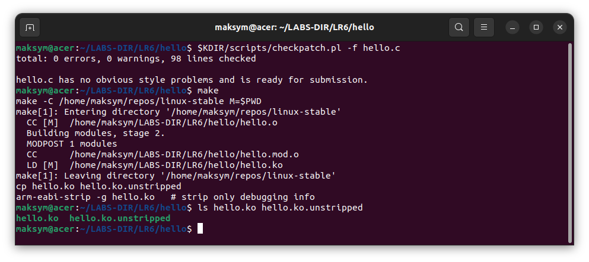<br>
  <i>Рисунок 4 – Результат checkpatch.pl, make та наявності hello.ko і hello.ko.unstripped</i>
</p>

### Частина 3. Отримання повідомлень в QEMU

Копіюємо hello.ko в кореневу файлову систему BusyBox, перепаковуємо CPIO-архів і запускаємо QEMU. Після кожної аварії систему краще перезапускати, бо ядро залишається в нестабільному стані.

```bash
cp hello.ko ~/repos/busybox/_install/root/
cd ~/repos/busybox/_install
find . | cpio -o -H newc | gzip > ../rootfs.cpio.gz
cd ..
qemu-system-arm -kernel _install/boot/zImage -initrd rootfs.cpio.gz -machine virt -nographic -m 512 --append "root=/dev/ram0 rw console=ttyAMA0,115200 mem=512M"
```

<p align="center">
  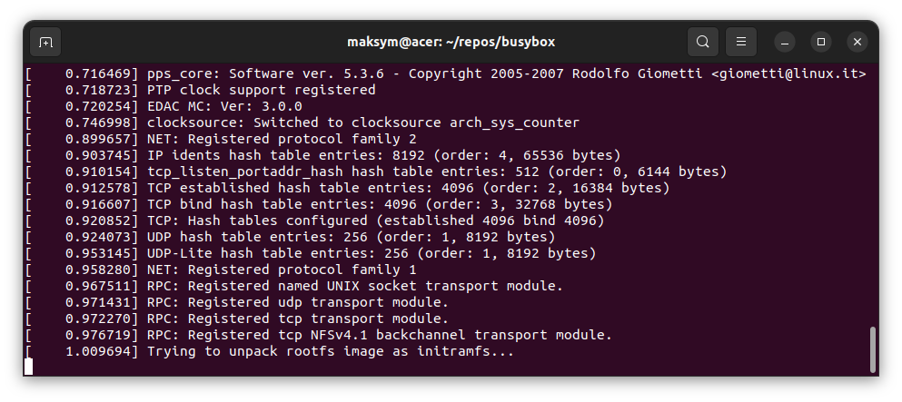<br>
  <i>Рисунок 5 – Запуск QEMU</i>
</p>

#### 3.1 Нормальна робота при count=3

```bash
insmod hello.ko count=3
ls /sys/module/hello/sections/
cat /sys/module/hello/sections/.text
cat /sys/module/hello/sections/.init.text
rmmod hello
```

<p align="center">
  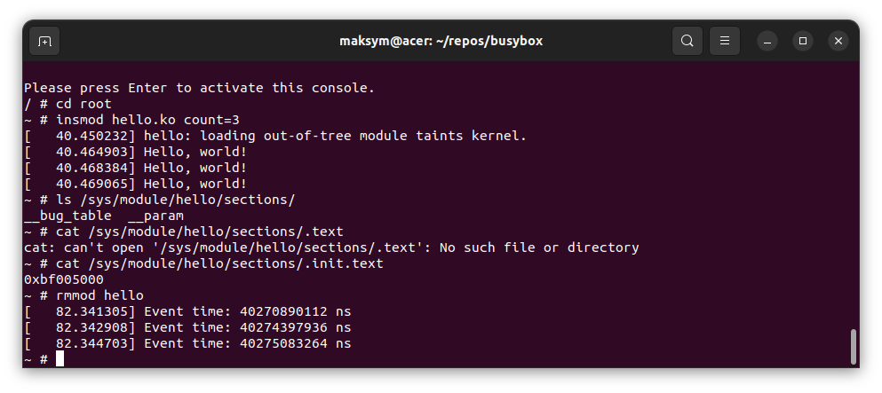<br>
  <i>Рисунок 6 – insmod з count=3, адреси секцій у /sys/module/hello/sections</i>
</p>

Команда ls не показує файли, імена яких починаються з крапки, тому .init.text читаємо безпосередньо через cat. Ця секція завантажена за адресою 0xbf005000. Файлу .text у каталозі немає, бо ця секція порожня (код модуля міститься в .init.text та .exit.text), а ядро не створює файлів для порожніх секцій.

#### 3.2 Спрацювання BUG_ON при count=15

```bash
insmod hello.ko count=15
lsmod
rmmod hello
```

<p align="center">
  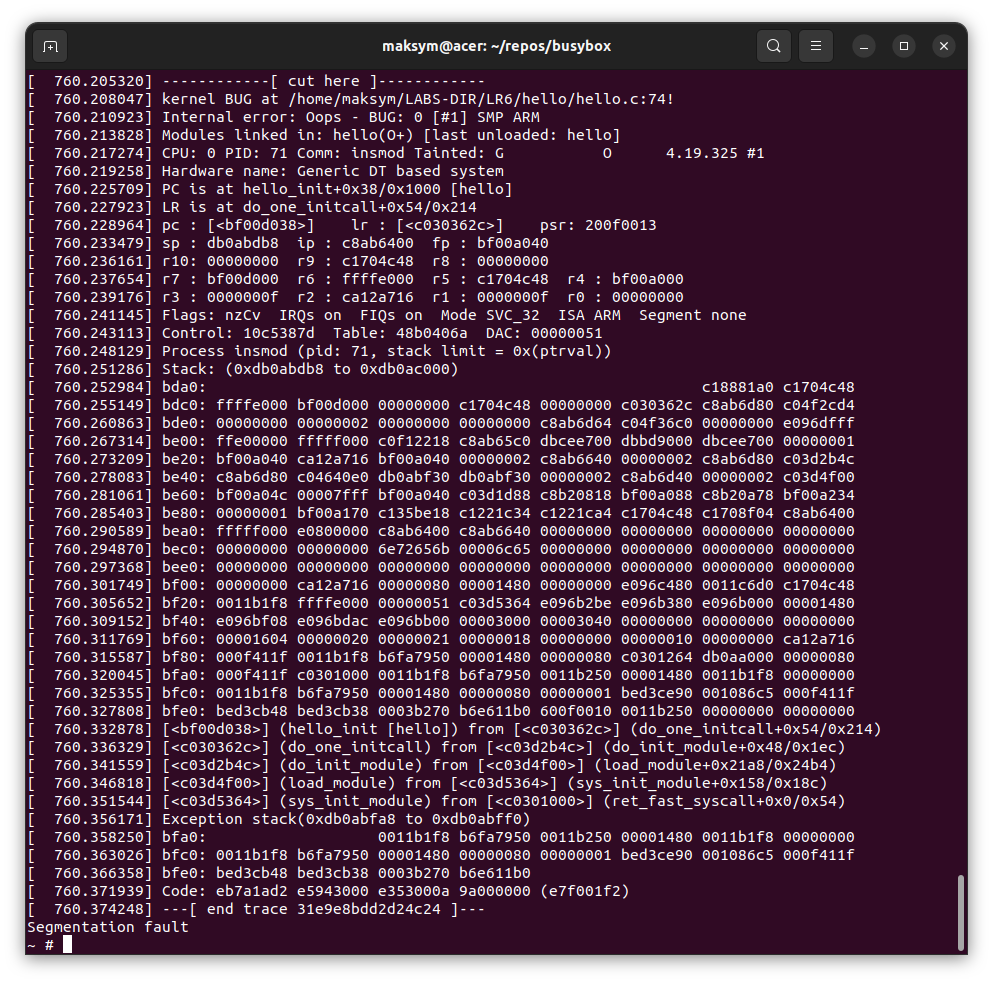<br>
  <i>Рисунок 7 – Повідомлення BUG (kernel BUG at hello.c:74!, Internal error: Oops - BUG)</i>
</p>

<p align="center">
  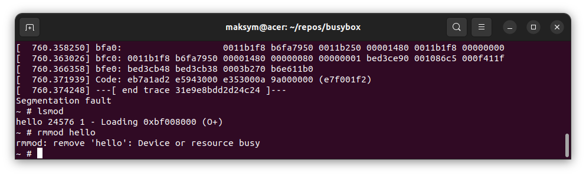<br>
  <i>Рисунок 8 – lsmod та спроба rmmod, модуль «зайнятий», вивантажити не вдається</i>
</p>

У повідомленні виведено «kernel BUG at /home/maksym/LABS-DIR/LR6/hello/hello.c:74!» (рядок з BUG_ON), «Internal error: Oops - BUG: 0 [#1] SMP ARM», «Modules linked in: hello(O+)» та «PC is at hello_init+0x38/0x1000 [hello]». Виконання BUG_ON() перериває функцію ініціалізації, тому insmod завершується аварійно (Segmentation fault), а модуль залишається в стані завантаження. Команда lsmod показує «hello 24576 1 - Loading», а rmmod повертає «Device or resource busy». Для наступного досліду QEMU запускаємо заново.

#### 3.3 Ін’єкція помилки kmalloc при count=7 (5-й елемент отримує NULL)

```bash
insmod hello.ko count=7
dmesg | grep -E 'Hello|Parameter'
```

<p align="center">
  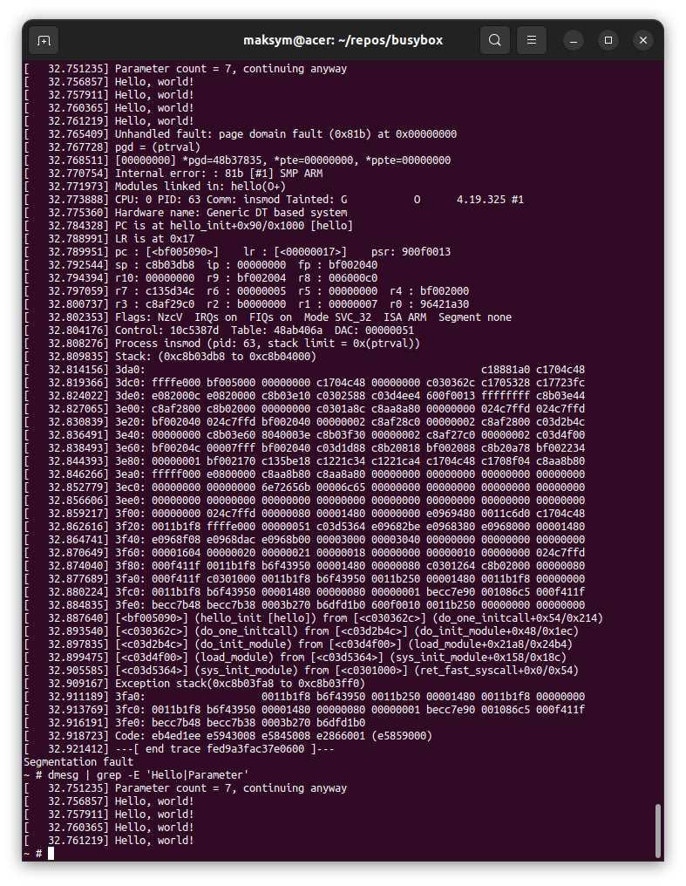<br>
  <i>Рисунок 9 – Oops: Unhandled fault: page domain fault (0x81b) at 0x00000000</i>
</p>

Перед аварією надруковано чотири привітання (елементи i = 0…3), а на п’ятому елементі (i == 4) ev дорівнює NULL. Ядро виводить «Unhandled fault: page domain fault (0x81b) at 0x00000000», «Internal error: : 81b [#1] SMP ARM», «Modules linked in: hello(O+)» та «PC is at hello_init+0x90/0x1000 [hello]». Значення pc дорівнює bf005090, а в регістрі r5 (вказівник ev) знаходиться 00000000. Нижче наведено стек викликів hello_init → do_one_initcall → do_init_module → load_module → sys_init_module → ret_fast_syscall. Процес insmod завершується з «Segmentation fault».

### Частина 4. Пошук місця аварії

Для аналізу беремо Oops з п. 3.3, оскільки він вказує на місце в коді (PC is at hello_init+0x90/0x1000). Дизасемблюємо модуль з налагоджувальною інформацією (hello.ko.unstripped) і знаходимо інструкцію за зміщенням 0x90.

```bash
${CROSS_COMPILE#ccache }objdump -dS hello.ko.unstripped | less
```

<p align="center">
  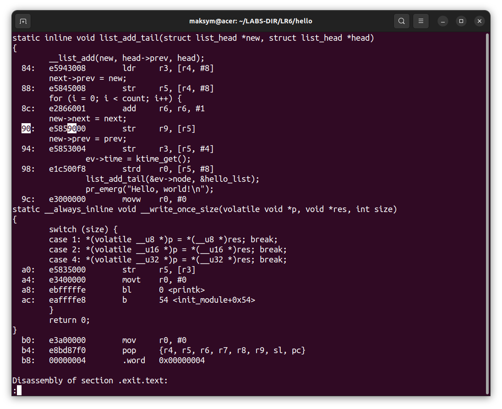<br>
  <i>Рисунок 10 – Фрагмент objdump -dS hello.ko.unstripped, інструкція за зміщенням 0x90 (hello_init+0x90) str r9, [r5]</i>
</p>

Те саме можна зробити в gdb. Кінцеву адресу збільшуємо на довжину інструкції, бо діапазон задається як [from, to).

```bash
arm-eabi-gdb -q hello.o
(gdb) disas hello_init+0x80,hello_init+0x90+4
(gdb) quit
```

<p align="center">
  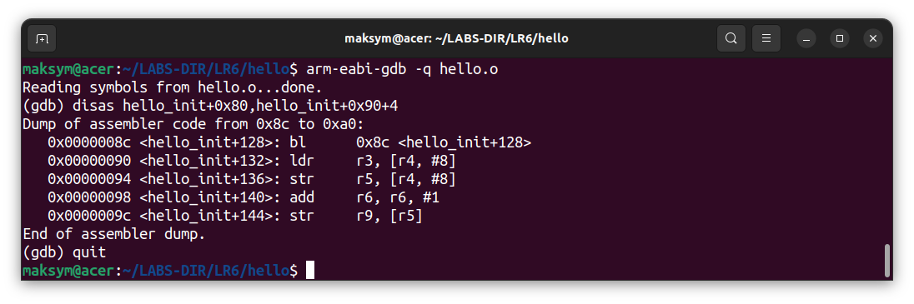<br>
  <i>Рисунок 11 – Результат disas у gdb</i>
</p>

За зміщенням 0x90 розташована інструкція str r9, [r5], яка в коді відповідає new->next = next у list_add_tail(). Регістр r5 зберігає вказівник ev, що дорівнює 0 (NULL), тому відбувається запис за адресою 0x00000000. Це збігається з повідомленням page domain fault at 0x00000000 у дампі Oops. Через оптимізацію компілятора запис ev->time = ktime_get() (strd r0, [r5, #8] за зміщенням 0x98) розміщено пізніше, тому першою спрацьовує операція над ev->node.

У gdb ця ж інструкція показана як hello_init+144. Це те саме зміщення, бо gdb виводить його в десятковому вигляді (144 = 0x90). Адреса 0x9c відрахована від початку секції в об’єктному файлі hello.o, тому вона відрізняється від зміщення всередині функції.

Перевірка за /sys/module/hello/sections/.init.text дає 0xbf005090 (PC) – 0xbf005000 (.init.text) = 0x90, що підтверджує рядок PC is at hello_init+0x90.

# Висновки

Отже, під час виконання лабораторної роботи (завдання 1) модуль із ЛР4 доповнено макросом BUG_ON() та примусовим поверненням NULL з kmalloc() на 5-му елементі списку, а також налаштовано збирання з налагоджувальною інформацією (-g, hello.ko.unstripped). У QEMU отримано аварії BUG_ON() (hello.c:74, модуль залишився «зайнятим») та Oops (page domain fault at 0x00000000, hello_init+0x90). За допомогою objdump та gdb за зміщенням 0x90 локалізовано проблемну інструкцію str r9, [r5] (r5 = 0) у list_add_tail(). Проблему відсутності старих залежностей arm-eabi-gdb в Ubuntu 22.04 усунено встановленням libtinfo5, libncursesw5 та libpython2.7. Вихідний код розміщено в репозиторії: https://github.com/BronievM/KPI-AK2/tree/main/LR6
